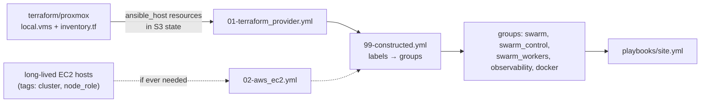

# Ansible: Inventory, Groups and Layout

**Status:** design, 2026-09-29. The Terraform side (`terraform/proxmox/inventory.tf`) exists. The Ansible files described below are being written on `feat/ansible-docker`.

**Audience:** anyone running or extending the Ansible code: adding a VM, adding the Kubernetes cluster, or wiring in AWS burst workers.

**Why it is built this way:** [ADR 0002](adrs/0002-terraform-labels-ansible-constructed-inventory.md). This page covers *how* it works.

---

## 1. The idea in one paragraph

Nobody writes a `hosts` file. Terraform already knows every VM, so it records each one in its state as an `ansible_host` resource with two **labels**: `cluster` and `node_role`. Ansible reads the hosts from Terraform state, and a single `constructed` inventory file turns the labels into groups. Terraform describes *what the machine is*; Ansible decides *what that means for configuration*. AWS burst workers are not in this inventory: Packer runs the same roles when it bakes their AMI, and they only join the cluster at boot ([ADR 0003](adrs/0003-configure-onprem-with-ansible-bake-burst-workers-with-packer.md)). If Ansible ever configures long-lived AWS hosts, they carry the same labels as EC2 tags and fall into the same groups through the same rules.



## 2. Directory layout

```
ansible/
  ansible.cfg                   # inventory = inventory/, roles_path = roles
  requirements.yml              # collections: cloud.terraform, community.docker
  inventory/
    01-terraform_provider.yml   # hosts + labels from Terraform state
    02-aws_ec2.yml              # only if long-lived AWS hosts need Ansible
    99-constructed.yml          # ALL grouping rules live here
  playbooks/
    site.yml                    # common → tailscale_routes → docker → swarm → node_exporter → stacks → keepalived → observability → rustfs
  roles/
    common/                     # base packages, timezone
    tailscale_routes/           # netplan return routes via ts-gateway on cluster nodes (docs/network.md §2.2)
    docker/                     # Docker engine + Compose plugin
    swarm/                      # swarm init (control) / join (workers)
    node_exporter/              # prometheus-node-exporter on every host
    observability/              # Prometheus + Grafana on obs-01 (docs/observability.md)
    rustfs/                     # RustFS (S3-compatible store) + bucket on obs-01 (docs/app.md)
    stacks/                     # copies stacks/swarm/ to swarm-ctl, deploys hba then monitoring (stacks_deploy)
```

Files in `inventory/` load in **alphabetical order**, which is why they are numbered. `99-constructed.yml` must sort last: it can only group hosts that earlier sources have already loaded.

**Settings live in each role's `defaults/main.yml`**, not in `group_vars/`. There is no `group_vars/` yet. If one is ever needed, put it **inside** `inventory/`, so it applies to hosts from every source, Terraform and EC2 alike. Not next to the playbooks: vars found relative to the playbook override those relative to the inventory, and two locations make it hard to see which value wins.

## 3. Labels (set in Terraform)

Every VM in `local.vms` (`terraform/proxmox/main.tf`) sets both labels. Both are required: a VM that belongs to no cluster says so with `cluster = "none"` rather than leaving the key out.

| Label | Values | Meaning |
|---|---|---|
| `cluster` | `swarm`, `k8s` (later), `none` | Which orchestrator cluster the node belongs to |
| `node_role` | `control`, `worker`, `observability` | What the node does in that cluster |

Current VMs:

| VM | `cluster` | `node_role` |
|---|---|---|
| `swarm-ctl` | `swarm` | `control` |
| `swarm-01` | `swarm` | `worker` |
| `obs-01` | `none` | `observability` |

`node_role` is used instead of `role` to stay clear of Ansible's `role_*` magic variables. `control` is used instead of Swarm's own word "manager" so the same vocabulary also works for Kubernetes control-plane nodes.

`inventory.tf` passes the labels to Ansible as host variables, next to `ansible_host` (the IP without the `/24`) and `ansible_user`. It sets **no `groups`**: group names belong to Ansible.

## 4. Inventory sources

### `01-terraform_provider.yml`

```yaml
plugin: cloud.terraform.terraform_provider
project_path: ../terraform/proxmox
```

The plugin runs `terraform show` in `project_path` and picks up every `ansible_host` (and `ansible_group`) resource in the root module.

- **Run Ansible from `ansible/`.** A relative `project_path` resolves against the directory Ansible is started from, not against the inventory file. `ansible.cfg` is only picked up from the current directory too, so this is one rule for both.
- **Terraform must be initialised** in `terraform/proxmox` (`terraform init`) with read access to the state bucket. On the Pi runner that is already the case. Locally it needs a read-only credential for the `proxmox/` state key.
- **Resources belong in the root module** (`terraform/proxmox/inventory.tf`), not inside `modules/vm`. Child modules are ignored unless `search_child_modules: true` is set.
- A VM appears in the inventory only after `terraform apply`. In CI this is the natural order: apply Terraform, then run Ansible.

### `99-constructed.yml`

```yaml
plugin: ansible.builtin.constructed
strict: false
groups:
  swarm:          cluster == 'swarm'
  swarm_control:  cluster == 'swarm' and node_role == 'control'
  swarm_workers:  cluster == 'swarm' and node_role == 'worker'
  observability:  node_role == 'observability'
  docker:         cluster == 'swarm' or node_role == 'observability'
```

- Each entry is a Jinja2 condition; a host that satisfies it joins the group.
- **Only host variables from earlier sources can be used.** Magic variables such as `groups` and `hostvars` do not exist yet while the inventory is being built. The labels come from Terraform, so they are available.
- `strict: false` (the default, set explicitly) means a failing expression is skipped instead of aborting. This keeps the inventory working when a source is empty, e.g. no burst workers running. The price: a host with a missing or misspelt label silently lands in **no** group. Section 6 shows how to catch that.
- `docker` is a policy decision, not a label: "Swarm nodes and the observability VM run Docker". It assumes Prometheus and Grafana run as containers on `obs-01`. When Kubernetes arrives (containerd, not Docker), this rule does not change.

## 5. Groups

| Group | Members | Used by |
|---|---|---|
| `all` | every host | `common`, `node_exporter` roles; the Prometheus `node` scrape job is generated from it |
| `docker` | Swarm nodes + `obs-01` | `docker` role |
| `swarm` | every Swarm node | `swarm` role |
| `swarm_control` | `swarm-ctl` | `swarm init`, `stacks` role (`docker stack deploy`), the autoscaler (`docker service update` only works on a manager) |
| `swarm_workers` | `swarm-01` (burst workers join at boot, outside Ansible) | `swarm join` |
| `observability` | `obs-01` | `observability` role ([docs/observability.md](observability.md)), `rustfs` role |
| `cluster_nodes` | every Swarm node, and the Kubernetes nodes once they exist | `tailscale_routes` role: return routes via `ts-gateway` ([docs/network.md](network.md) §2.2) |

Group names follow Ansible's variable-name rules: letters, digits and underscores, no dashes.

Plays target groups directly, e.g. `hosts: swarm_control`. Inside templates, "the" control node is `groups['swarm_control'][0]`.

## 6. Checking the inventory

Run from `ansible/`:

```bash
# one source on its own, before combining
ansible-inventory -i inventory/01-terraform_provider.yml --graph

# the full, combined inventory
ansible-inventory --graph

# labels and connection vars of one host
ansible-inventory --host swarm-ctl

# can Ansible reach everything?
ansible all -m ping
```

Expected `--graph` output (abridged):

```
@all:
  |--@ungrouped:
  |--@swarm:
  |  |--swarm-ctl
  |  |--swarm-01
  |--@swarm_control:
  |  |--swarm-ctl
  |--@swarm_workers:
  |  |--swarm-01
  |--@observability:
  |  |--obs-01
  |--@docker:
  |  |--swarm-ctl
  |  |--swarm-01
  |  |--obs-01
```

**A host listed under `ungrouped` has missing or misspelt labels.** That is the check that makes `strict: false` safe.

## 7. Extending it

**Add a VM to an existing cluster** (e.g. `swarm-02`): add it to `local.vms` with its labels, apply Terraform. Nothing changes on the Ansible side. For a worker node, also raise `max_replicas` in `stacks/swarm/autoscaler-policy.yml` by 2 per node, or the autoscaler never uses it ([autoscaler.md](autoscaler.md) §3).

**Add the Kubernetes cluster:** give the K8s VMs `cluster = "k8s"` and `node_role = "control"`/`"worker"` in Terraform, then add the rules in `99-constructed.yml`:

```yaml
  k8s:          cluster == 'k8s'
  k8s_control:  cluster == 'k8s' and node_role == 'control'
  k8s_workers:  cluster == 'k8s' and node_role == 'worker'
```

A stopped cluster's VMs stay in Terraform state and therefore in the inventory. Limit runs to the active cluster (`--limit swarm` or `--limit k8s`), or `ping` will time out on the powered-off one.

**AWS burst workers are not added here.** They are configured when Packer bakes their AMI, running the same roles, and join the cluster at boot ([ADR 0003](adrs/0003-configure-onprem-with-ansible-bake-burst-workers-with-packer.md)). Keep the roles free of anything Proxmox-specific so Packer can reuse them.

**Add long-lived AWS hosts not created by Terraform** (if ever needed): tag the instances with `cluster` and `node_role` and map the tags onto the same variable names:

```yaml
# 02-aws_ec2.yml  (the aws_ec2 plugin requires the name to end in aws_ec2.yml)
plugin: amazon.aws.aws_ec2
regions: [eu-central-1]
filters:
  tag:managed-by: ansible
  instance-state-name: running
compose:
  cluster: tags.cluster
  node_role: tags.node_role
  ansible_host: private_ip_address   # or the Tailscale IP, once decided
```

`99-constructed.yml` then places them in the matching groups with no new rules.

**Add a Terraform-managed EC2 host** (none is planned: the k6 host was dropped, [ADR 0008](adrs/0008-run-k6-from-the-laptop-not-an-aws-host.md)): add an `ansible_host` resource in `terraform/aws`, a new `cluster`/`node_role` pair, and a second inventory file pointing at `../terraform/aws`. A separate file rather than a list in `01-terraform_provider.yml` means a Proxmox-only run does not need AWS credentials: `-i inventory/01-terraform_provider.yml -i inventory/99-constructed.yml`.

## 8. Run speed

The full apply took 161 s, 101 s of it in two apt tasks that changed nothing. Two settings brought it to 52 s (2026-10-14):

- **apt refreshes only when needed.** Ubuntu packages are pinned to a snapshot date, so their lists only change with that date. The common role forces a refresh when the pin changes, otherwise at most once a day (`cache_valid_time`). The docker role refreshes only when the Docker repo definition changes.
- **`pipelining = True`** in `ansible.cfg`: each task is one SSH command instead of mkdir, upload, chmod, run and cleanup.

**Edge case:** Docker's repo is not snapshotted, so its list on the VMs can be up to a day old. Bumping `docker_packages` to a release from the last day fails at "Install Docker" (version not found). Rerun the next day, or set `cache_valid_time: 0` in the common role for one run.

## 9. Sources

- [ansible.builtin.constructed inventory plugin](https://docs.ansible.com/projects/ansible-core/devel/collections/ansible/builtin/constructed_inventory.html): options, `strict`, the rule that only variables from earlier sources are available.
- [How to build your inventory](https://docs.ansible.com/projects/ansible/latest/inventory_guide/intro_inventory.html): inventory directories, alphabetical load order, `group_vars` precedence, group name rules.
- [How to combine static and dynamic inventories in Ansible (OneUptime)](https://oneuptime.com/blog/post/2026-02-21-how-to-combine-static-and-dynamic-inventories-in-ansible/view): numbered sources, `constructed` last, `group_vars` inside the inventory directory, testing each source separately.
- [cloud.terraform `terraform_provider` plugin source](https://github.com/ansible-collections/cloud.terraform/blob/main/plugins/inventory/terraform_provider.py): `project_path` handling, child modules.
- [`ansible_host` Terraform resource](https://github.com/ansible/terraform-provider-ansible/blob/main/docs/resources/host.md)
- [AWS EC2 dynamic inventory guide](https://docs.ansible.com/projects/ansible/latest/collections/amazon/aws/docsite/aws_ec2_guide.html)
- [`apt` module (`update_cache`, `cache_valid_time`)](https://docs.ansible.com/projects/ansible/latest/collections/ansible/builtin/apt_module.html), [Ubuntu snapshot service](https://documentation.ubuntu.com/server/how-to/software/snapshot-service/), [`pipelining` (config reference)](https://docs.ansible.com/projects/ansible/latest/reference_appendices/config.html)
