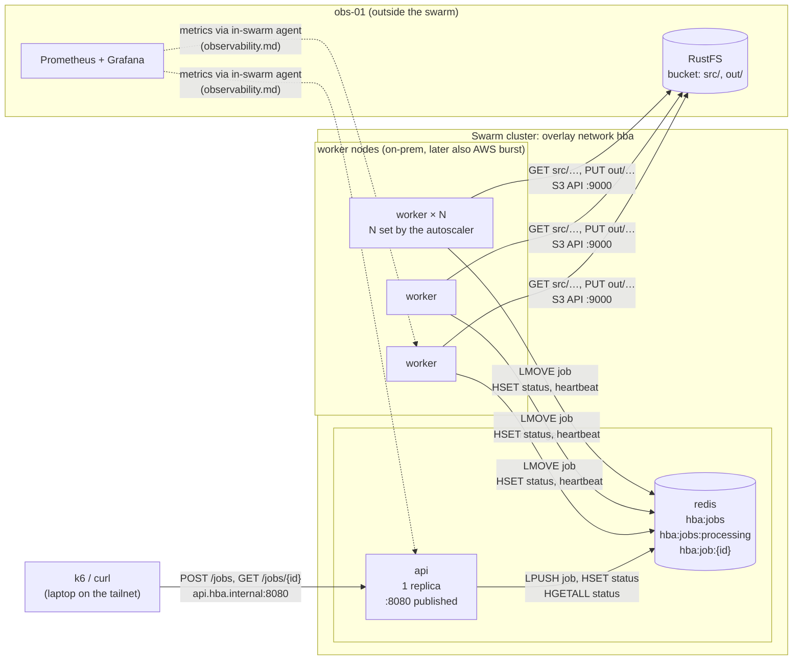

# App: How the API, Redis, Workers and Storage Interact

**Status:** 2026-10-23. The app runs end to end in the local dev stack (`app/docker-compose.dev.yml`). RustFS runs on `obs-01` with its bucket (Ansible `rustfs` role). All three services run on Swarm (section 4); the first job went through the cluster end to end on 2026-10-13 (`small` preset, worker on `swarm-01`, output in RustFS). `medium` is calibrated and frozen (section 5); automatic image bumps and the API's token auth are still missing.

**Audience:** anyone deploying the app to Swarm or Kubernetes, writing k6 scripts, or reading the C# code for the first time. The Swarm autoscaler has its own doc: [autoscaler.md](autoscaler.md).

**Related:** [docs/csharp-workload-v1.2.md](csharp-workload-v1.2.md) (the full design and contract), [docs/cluster-vip.md](cluster-vip.md) (`api.hba.internal`), [docs/observability.md](observability.md) (how the metrics reach Prometheus), [app/worker.md](../app/worker.md) (worker settings).

---

## 1. The idea in one paragraph

The API and the workers never talk to each other. The API **puts** a job into Redis and answers `202 Accepted` at once; workers **pull** jobs out of Redis, process them, and write the job's status back into Redis; the API **reads** that status when a client asks. Redis in the middle is deliberate: the number of jobs waiting in `hba:jobs` is the signal both autoscalers scale on, and pull-based workers need no inbound connection, which is what lets AWS burst workers join without any routing changes (workload doc §3).

## 2. Where everything runs



| Connection | Protocol | Address used | Purpose |
|---|---|---|---|
| client → api | HTTP | `api.hba.internal:8080` (cluster VIP) | submit jobs, read status |
| api → redis | Redis | `redis:6379` (service name on the overlay) | enqueue, read status |
| worker → redis | Redis | `redis:6379` | take jobs, write status and heartbeats, reaper |
| worker → RustFS | S3 (path-style) | `http://<obs-01>:9000` on-prem; Amazon S3 for burst workers | read source images, write results |
| Prometheus → api, workers | HTTP `/metrics` | through the in-swarm agent, not published ports | measurements |

Nothing calls the worker's HTTP port except Prometheus and the health checks. The API never touches storage, and never processes an image.

## 3. The life of one job

```mermaid
sequenceDiagram
    autonumber
    participant C as client (k6 / curl)
    participant A as api
    participant R as redis
    participant W as worker
    participant S as RustFS

    C->>A: POST /jobs {input_key, preset}
    A->>A: validate key pattern and preset name
    A->>R: MULTI: HSET hba:job:{id} status=queued, EXPIRE 24h, LPUSH hba:jobs message
    A-->>C: 202 Accepted, Location: /jobs/{id}

    W->>R: LMOVE hba:jobs → hba:jobs:processing (oldest job first)
    W->>R: MULTI: HSET status=processing, worker, tier, heartbeat_at; HINCRBY attempts
    loop every 5 s while the job runs
        W->>R: HSET heartbeat_at
    end
    W->>S: GET src/{name}
    W->>W: decode, resize, encode (1 CPU, preset settings)
    W->>S: PUT out/{id}.{ext}
    W->>R: Lua: LREM from processing + HSET status=done (one atomic step)

    C->>A: GET /jobs/{id}
    A->>R: HGETALL hba:job:{id}
    A-->>C: 200 {status: done, output_store: rustfs, output_key, …}
```

If anything goes wrong, the job never just disappears:

- **Temporary error** (Redis or storage timeout): the job goes back to the front of the queue, up to 3 attempts in total.
- **Permanent error** (missing or unreadable image, unknown preset): status `failed`, no retry.
- **Worker killed mid-job**: its heartbeat stops; another worker's **reaper** puts the job back in the queue once the heartbeat is older than 60 s (or missing on two checks 30 s apart).
- **Worker stopped at scale-down**: it finishes the current job (up to 25 s); if it can't, it puts the job back before exiting.

Details and reasons: workload doc §6 (Redis), §10 (worker rules).

## 4. Swarm services

| Service | Image | Placement | Replicas | Notes |
|---|---|---|---|---|
| `api` | `ghcr.io/krisztiankirschner/hba-api:sha-…` | manager | 1 | port 8080 published; reached through the VIP |
| `redis` | `redis:8.8.3-alpine` | manager | 1 | not published |
| `worker` | `ghcr.io/krisztiankirschner/hba-worker:sha-…` | worker nodes | set by the autoscaler ([autoscaler.md](autoscaler.md)); 1 in the file | 1 CPU limit and reservation; `stop_grace_period: 30s`; health check off; storage keys as Swarm secrets (`HBA_S3_*_FILE`) |

CI tags both images with the same commit SHA, so the stack can pin `api` and `worker` to one commit. The manager runs no worker replicas, so the API and Redis never compete with the work being measured.

Worker settings that the measurements depend on:

- **CPU limit and reservation of 1.** The limit makes one replica one vCPU. The reservation makes Swarm leave a task `Pending` when the nodes are full instead of oversubscribing them: a 2-vCPU node holds 2 replicas, a third waits. That `Pending` state is the planned burst trigger.
- **`stop_grace_period: 30s`.** The worker needs up to 25 s (`HBA_SHUTDOWN_TIMEOUT_SECONDS`) to finish or requeue its job. Swarm's default of 10 s would kill jobs on every deploy and scale-down.
- **Health check disabled.** See [ADR 0004](adrs/0004-no-liveness-check-on-workers.md).
- **`HBA_NODE_NAME: "{{.Node.Hostname}}"`.** Swarm fills in the node name per task; with `HBA_TIER=auto` a node named `burst-…` makes the worker use S3 instead of RustFS. The `stacks` role copies the file without templating, so Ansible leaves the braces alone.
- **Secrets.** `rustfs_access_key` and `rustfs_secret_key` are `external` in the stack and created by the `stacks` role from `RUSTFS_ACCESS_KEY` / `RUSTFS_SECRET_KEY`. Swarm secrets are immutable: rotating the keys needs new secret names, because a secret in use cannot be replaced.

**Every deploy resets the worker count.** `docker stack deploy` sets the worker's replicas back to the `1` in the file, overriding the autoscaler. The controller corrects it in its next iteration, within 5 s ([autoscaler.md](autoscaler.md) §7). Don't deploy during a test run.

### 4.1 Same settings on Kubernetes

The worker config is chosen so that every Swarm setting has a direct Kubernetes equivalent. This is the checklist for the Kubernetes manifests:

| Swarm (`hba.yml`) | Kubernetes |
|---|---|
| `environment:` | `env:` in the Deployment |
| Swarm secrets + `HBA_S3_*_FILE` | Secret mounted as files, same `_FILE` variables |
| `HBA_NODE_NAME: "{{.Node.Hostname}}"` | Downward API: `fieldRef.fieldPath: spec.nodeName` |
| `limits.cpus` / `reservations.cpus: "1"` | `resources.limits.cpu` / `requests.cpu: 1` |
| `stop_grace_period: 30s` | `terminationGracePeriodSeconds: 30` |
| placement `node.role == worker` | default: the control-plane taint keeps pods off the control node |
| `healthcheck: disable: true` | no `livenessProbe` |
| `replicas:` | left out; KEDA owns it |

## 5. What is still missing on the cluster

Done: worker image on GHCR (`ci/worker-image`), RustFS on `obs-01` with the `hybrid-burst-data` bucket (MinIO was the original plan; its images are no longer published), worker service in the stack and the `api` image bumped from `sha-22b2334`, which had no `POST /jobs`.

### Preset calibration (done 2026-10-23)

The first `small` job took about 0.6 s, well below the 2–5 s per job the design assumes, so the presets were calibrated on the cluster under the 1-CPU limit: one job at a time ([`loadtest/calibrate.py`](../loadtest/calibrate.py)), one replica on `swarm-01`, five rounds over every image of the set. Evaluation: [`analysis/calibration.ipynb`](../analysis/calibration.ipynb); data in `analysis/data/calibration/`. Two versions are tracked on purpose: the **preset version** (the settings in `ImagePresets.cs`, the CSV file name) and the **image set version** (the `source_set` column).

| Round | Presets | Image set | `medium` median | What happened |
|---|---|---|---|---|
| 16 Oct | v0 | v1 | 0.84 s | far too short; `medium` raised to 3600 px |
| 16–17 Oct | v1 | v1 | 2.40 s | on target, but CEERS11 and weic2303a cost only 0.81–0.82 × the median |
| 16 Oct, 23 Oct | v1 | **v2** | **2.36 s** | those two images replaced; every check passes |

Result for **presets v1 on image set v2** (75 `medium` and 82 `large` jobs, seven images):

| Check (pass if) | `medium` | `large` |
|---|---|---|
| median on target (`medium` 2–3 s, `large` 4.5–5.5 s) | 2.36 s, pass | 6.12 s, **fail** |
| p95 / median < 1.2 | 1.11, pass | 1.33, **fail** |
| every image within 0.85–1.15 × the set median | 0.90–1.11, pass | 0.87–1.28, **fail** (img-05) |
| spread between image medians < 10 % | 6.3 %, pass | 12.3 %, **fail** |
| round 1 within 5 % of later rounds (no caching) | +0.8 %, pass | +0.2 %, pass |

**Decisions:**

- **`medium` is the job type of every measured run**, in k6 and in both orchestrators. `large` misses its targets and is not used: recalibrating it would need a new preset version and a new image for something the comparison does not need (the thesis needs one well-calibrated CPU-bound job type, workload doc §11.4).
- **Frozen:** preset version v1 (worker image `hba-worker:sha-5de4c05`), image set v2 ([`loadtest/source-set/`](../loadtest/source-set/README.md), the same seven files in RustFS and S3), and ImageSharp 3.1.12 (4.x would change the cost per job and invalidate the numbers). A change to any of them means a new calibration.
- **`jobs_per_replica` stays 5** ([autoscaler.md](autoscaler.md) §3): five jobs of 2.36 s are about 12 s of queued work per replica, close to the 5–15 s age of the queue data the controller sees. The KEDA `listLength` must be the same value, so that both autoscalers size by the same rule.

Still missing, in order:

1. **Automatic image bumps** (parked as a future idea, 2026-10-16; not needed for the thesis). CI pushes new `sha-…` tags but nothing updates the stacks; today a second, hand-made PR changes the tag. Options considered, all keeping the tag pinned (no floating `:latest`, so images stay frozen during comparison runs):
   - **Bot bump PR:** a job after the image push edits the tag in the stack and opens a PR (`peter-evans/create-pull-request`); merging it deploys. Smallest change, keeps `sha-` tags.
   - **release-please:** version numbers (`0.2.0`) counted up from `feat:`/`fix:` commits, one release PR that collects changes, plus a changelog. Nicer, more setup.
   - **Manual `VERSION` file** read by both CI and the stack: one PR per change, but the bump is by hand.

   Things to know for any of them: PRs opened with `GITHUB_TOKEN` trigger no workflows (no checks on the bump PR); the repo must allow Actions to create PRs; and the deploy must wait until the new image tag exists on GHCR.
2. **API token auth** (workload doc §5.6): **decided against for this project** (2026-10-23). The API is reachable only from the tailnet and the VPC, and that network layer is the access control for k6 as well. Named as a limitation in the report: anything on the tailnet can submit jobs.

## 6. Running it locally

`app/docker-compose.dev.yml` runs the same four pieces on one machine (Redis, RustFS, API, one worker); the steps are at the top of that file. It has no CPU limits, so its timings are not calibration data.
