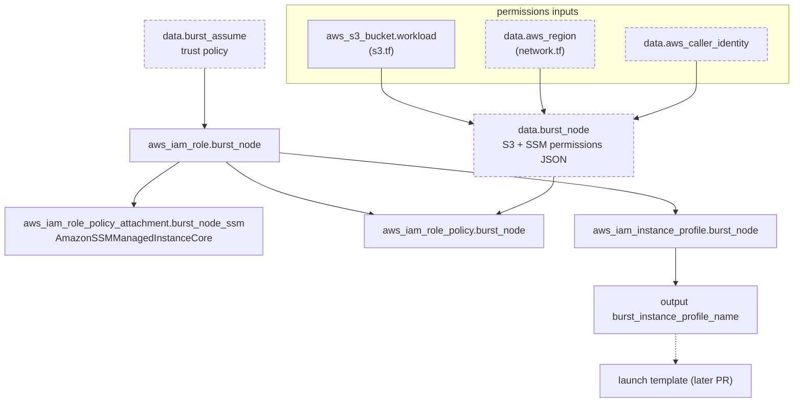

# AWS: Burst-Tier Scaffolding

**Status:** 2026-10-24. `terraform/aws` is live with the network (#45), the workload bucket (#46), the CI credentials fix (#47), the burst-node IAM role (#48) and the Tailscale gateway instance `hba-aws-gateway` (#53), which has a direct path to the lab (about 20 ms; [ADR 0007](adrs/0007-site-to-site-with-two-linux-tailscale-routers.md), [network.md §2.2](network.md)). A throwaway burst node joined the swarm over it and ran jobs on 2026-10-21. Launch templates, ASGs and the burst AMI are not built yet. There is no AWS load-generator host: k6 runs from the laptop ([ADR 0008](adrs/0008-run-k6-from-the-laptop-not-an-aws-host.md)).

**Audience:** anyone changing `terraform/aws`, or wiring burst workers to S3 and SSM.

**Related:** [docs/terraform.md](terraform.md) (layout, state, pipeline), [docs/network.md](network.md) (address plan), [docs/burst.md](burst.md) (launch template, Auto Scaling group, burst controller), [ADR 0003](adrs/0003-configure-onprem-with-ansible-bake-burst-workers-with-packer.md) (how burst workers boot).

---

## 1. What exists

Everything here is free while idle. Nothing runs until burst instances are launched.

| File | Resources | Notes |
|---|---|---|
| `network.tf` | VPC `10.100.0.0/16`, 3 public subnets (one per AZ in `eu-central-1`), internet gateway, route table, S3 gateway endpoint, security group `hba-burst-node` | No NAT gateway: it costs money while idle and forces Tailscale onto DERP relays. The security group has **no ingress rules**, only all egress. |
| `s3.tf` | Bucket `hybrid-burst-data`, public access block, lifecycle rules | Same name as the RustFS bucket, because the worker has one `HBA_S3_BUCKET`. `out/` expires after 7 days; `src/` is kept. |
| `iam.tf` | Role and instance profile `hba-burst-node`, scoped inline policy, `AmazonSSMManagedInstanceCore` | Section 2 |

## 2. Burst-node IAM (`iam.tf`)

A burst worker needs S3 access for its results and SSM access for its join parameters, without any access key stored on the node. EC2 provides that through an **instance profile**: the launch template names the profile, EC2 assumes the role inside it at boot, and the instance metadata service hands short-lived credentials to the AWS SDK in the worker.

### Dependency graph

Terraform orders resources by their references. Read the graph top to bottom: an arrow points from a block to the block that needs it, so the apply runs in arrow order.

Dashed boxes are data sources (`data.*`): they only build JSON or read values, and create nothing in AWS. The dotted arrow is a future link, not part of this PR.

| Block | Needs | Why |
|---|---|---|
| `burst_assume` (data) | nothing | Trust policy: only the EC2 service may assume the role. It says *who* may use the role, not *what* the role may do. |
| `aws_iam_role.burst_node` | `burst_assume` | A role can't exist without a trust policy. It starts with **no permissions**; it inherits nothing from the CI user that creates it. |
| `aws_iam_instance_profile.burst_node` | the role | EC2 only accepts a profile, never a role directly. The console creates one silently; Terraform needs it explicitly. |
| `burst_node` (data) | bucket ARN, region, account ID | Builds the permissions JSON. |
| `aws_iam_role_policy.burst_node` | the role, `burst_node` | Inline policy: belongs to this role only and is deleted with it. |
| `aws_iam_role_policy_attachment.burst_node_ssm` | the role | Session Manager shell for debugging: no SSH key, no ingress rule. |

**Apply order:** data sources, then the role, then the profile, the inline policy and the attachment in parallel. **Destroy** runs in reverse: AWS refuses to delete a role that still has policies or a profile attached.

### Why the S3 policy is custom

The CI user uses broad AWS-managed policies (section 3). This role doesn't, because its credentials are reachable by every process on an internet-connected node, including containers through the metadata service. AWS-managed S3 policies can't be limited to one bucket, so even `AmazonS3ReadOnlyAccess` would let a compromised node read `hybrid-burst-tfstate`. The custom policy limits it to reading and writing objects in `hybrid-burst-data`; it can't even delete.

## 3. Credentials

Each Terraform root has its own IAM user. In one run, the S3 backend and the AWS provider use the **same** credentials (`AWS_ACCESS_KEY_ID` / `AWS_SECRET_ACCESS_KEY`), so the AWS user also needs state access.

| User | Used by | Policies |
|---|---|---|
| `tf-state-proxmox` | `terraform-proxmox.yml`, `ansible.yml` | State access only |
| `tf-aws` | `terraform-aws.yml` (secrets `TERRAFORM_AWS_*`) | `AmazonEC2FullAccess`, `AmazonS3FullAccess`, `IAMFullAccess`; `AmazonSSMFullAccess` once Terraform manages SSM parameters |

AWS-managed policies were chosen on the course's advice: standard, maintained by AWS, recognisable. The risk is limited by where the keys live: only GitHub secrets, used only on the self-hosted Pi, with every apply behind an approval in the `aws` environment.

**Correction:** the first AWS apply (#45) failed with `ec2:CreateVpc` denied. The new workflow had been copied from the Proxmox one and still used `tf-state-proxmox`, which has state access only. The plan had passed because nothing existed yet, so it needed no EC2 calls. `tf-aws` was created and the workflow switched to it in #47.

## 4. Tailscale credentials and the first join test

> **Superseded in part (2026-10-20).** Burst nodes no longer run Tailscale: a gateway instance in the VPC and `ts-gateway` in the lab connect the two networks ([ADR 0007](adrs/0007-site-to-site-with-two-linux-tailscale-routers.md), [network.md §2.2](network.md)). The two routers use ordinary, non-ephemeral keys with key expiry disabled. The OAuth client below is now only needed for a node that has to join by itself (no such node is planned: the k6 host was dropped, [ADR 0008](adrs/0008-run-k6-from-the-laptop-not-an-aws-host.md)). The test procedure and the lessons stay valid: they are how the network path was proven.

This section was written when burst nodes and the k6 host were to join the tailnet themselves. That needs a credential that a booting node can fetch without a human.

| Item | Value |
|---|---|
| Credential | An **OAuth client** (Settings → Trust credentials), not a plain auth key: plain keys expire after at most 90 days, which is past the end of the semester. |
| Scopes | **Auth Keys: Write** and **Devices: Core (Write)**, plus the tags `tag:burst` and `tag:loadgen`. Nothing else. |
| Where the secret lives | SSM SecureString `/hba/tailscale-oauth-secret`, created by hand on 2026-10-17. The burst role's `JoinParameters` statement can read `/hba/*`. |
| What is stored | The **whole** secret string, including the `tskey-client-` prefix. The client ID is not needed to join. |
| How a node uses it | `tailscale up --auth-key="<secret>?ephemeral=true&preauthorized=true" --advertise-tags=tag:burst --accept-routes --hostname=<name>`. Ephemeral nodes drop out of the tailnet on their own after termination. |

**Why SSM and not a GitHub secret.** The reader is a node that boots by itself in the middle of a test, with no pipeline run behind it, so it cannot get a GitHub secret. Other places are worse: an AMI can be copied, and user data is readable by anything that reaches the metadata service and ends up in Terraform state. Later, the pipeline can copy the GitHub secret into SSM with `value_wo` (Terraform 1.11+, keeps the value out of state); that needs `AmazonSSMFullAccess` on `tf-aws`.

### Test procedure (throwaway instance, a few cents)

1. EC2 console: Ubuntu, `t3.micro` (a connectivity test, not a measurement), no key pair, VPC `hba-burst`, **auto-assign public IP on**, security group `hba-burst-node`, **IAM instance profile `hba-burst-node`**, IMDSv2 required with **hop limit 2**.
2. Connect with **Session Manager** (no SSH key, no port).
3. Install the AWS CLI and Tailscale, read the secret from SSM, run `tailscale up` as above.
4. `tailscale status` must show the node with `tag:burst`. Terminate the instance afterwards.

For a quick test without the OAuth client, a one-day, ephemeral, pre-approved auth key with `tag:burst` (Settings → Keys) works the same way. Revoke it afterwards and never store it.

### What went wrong on the way (kept on purpose)

| Symptom | Cause | Lesson |
|---|---|---|
| Session Manager "Not connected", IAM Role field empty | The instance was launched **without** the instance profile. The SSM agent started with no credentials and retries slowly, so attaching the role afterwards did not help until a **reboot**. | The launch template must set `iam_instance_profile`. A node that is missing from Session Manager a few minutes after its *first* boot has a different cause: public IP, AMI or egress rule. |
| `tailscale up` failed with `404 not found` | The OAuth client did not have a usable scope and tags. Setting Devices Core (Write) and adding the tags fixed it. | Create the client with the two scopes and the tags together, after the tags exist in `tagOwners`. The UI does not explain this; no tags field appeared until then. |
| `unable to validate API key` | The `tskey-client-` prefix had been deleted from the stored secret. | The prefix is part of the secret: it is how Tailscale tells a client secret from an API key. |
| The client was first created with every scope | Done to get unblocked. A secret that every burst node (and any container on it) can read would then administer the whole tailnet. | Narrow to the two scopes above before the secret is used for real, and delete the broad client. |
| A capture on `swarm-ctl` showed only `10.0.20.1` | OPNsense pings the VMs about once a second, so that address is always there. | Fingerprint the test packet (`-s 200`, `greater 200`). Details in [network.md §2.1](network.md). |

## 5. Known gaps

- **`IAMFullAccess` is effectively admin.** `tf-aws` could create a role with any policy and use it. A permissions boundary would close this; out of scope for this project and named in the report's limitations.
- **`AmazonS3FullAccess` covers every bucket,** including `hybrid-burst-tfstate`. Versioning on the state bucket allows recovery.
- **`AmazonSSMManagedInstanceCore` grants `ssm:GetParameter(s)` on `*`.** The `/hba/*` scoping in the inline policy therefore has no effect, and a burst node can read every SSM parameter in the account. This became a real problem once the AWS gateway's Tailscale secret was to live in SSM. **Decided 2026-10-20 ([ADR 0007](adrs/0007-site-to-site-with-two-linux-tailscale-routers.md)), to be done in the gateway PR:** separate paths (`/hba/burst/*`, `/hba/gateway/*`), and the managed policy replaced on both roles by the five Session Manager actions only.

## 6. Sources

- [Tailscale: OAuth clients](https://tailscale.com/kb/1215/oauth-clients), [ephemeral nodes](https://tailscale.com/kb/1111/ephemeral-nodes), [install on AWS EC2](https://tailscale.com/docs/install/cloud/aws/quickstart)

- [IAM roles for EC2 and instance profiles](https://docs.aws.amazon.com/AWSEC2/latest/UserGuide/iam-roles-for-amazon-ec2.html)
- [AmazonSSMManagedInstanceCore](https://docs.aws.amazon.com/aws-managed-policy/latest/reference/AmazonSSMManagedInstanceCore.html)
- [Permissions boundaries](https://docs.aws.amazon.com/IAM/latest/UserGuide/access_policies_boundaries.html)
- [Tailscale: AWS reference architecture](https://tailscale.com/docs/reference/reference-architectures/aws)
- Terraform: [aws_iam_role](https://registry.terraform.io/providers/hashicorp/aws/latest/docs/resources/iam_role), [aws_iam_instance_profile](https://registry.terraform.io/providers/hashicorp/aws/latest/docs/resources/iam_instance_profile), [aws_iam_policy_document](https://registry.terraform.io/providers/hashicorp/aws/latest/docs/data-sources/iam_policy_document)
