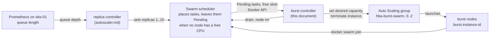
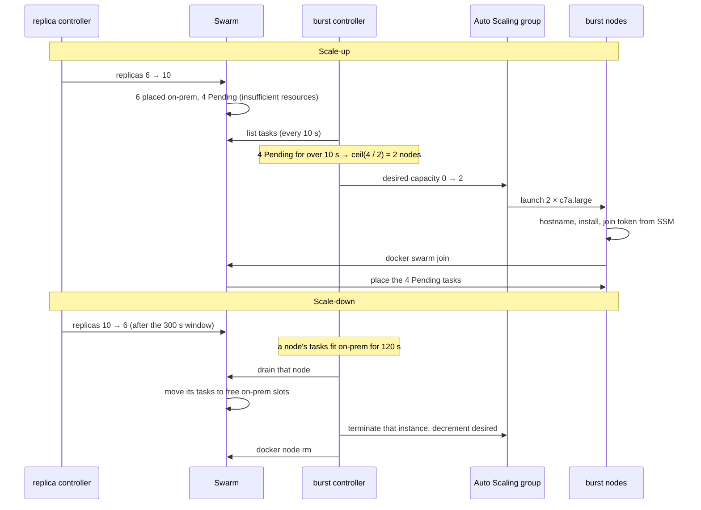

# Burst Controller

**Status:** 2026-11-18. **Built and measured on both orchestrators.** On Swarm: the launch template, the Auto Scaling group `hba-burst-swarm` and its boot script (`terraform/aws/burst.tf`, `autoscaling.tf`), and the controller (`autoscaler/burst/`) with its Swarm adapter; three measured burst runs on 2026-11-16 ([loadtest.md](loadtest.md) §4.5). On Kubernetes: a second group `hba-burst-k8s` whose nodes join as k3s agents (§7.1), and the same controller with a Kubernetes adapter (§1.1); three measured burst runs on 2026-11-17 ([loadtest.md](loadtest.md) §4.9). The decisions are recorded in [ADR 0009](adrs/0009-separate-burst-controller-resizing-an-auto-scaling-group.md); the build order is in §10.

**Audience:** anyone building or changing the burst tier (Terraform, user data, the controller), and anyone comparing it with the Kubernetes Cluster Autoscaler.

**Related:**
- [docs/autoscaler.md](autoscaler.md): the replica controller, which this design leaves unchanged;
- [docs/aws.md](aws.md): VPC, instance profile, S3;
- [docs/network.md](network.md) §2.2: how burst nodes reach the lab;
- [ADR 0003](adrs/0003-configure-onprem-with-ansible-bake-burst-workers-with-packer.md): boot path and Packer;
- [docs/security.md](security.md): where credentials live.

**Summary:** A second, separate controller adds AWS nodes when the scheduler can't place worker tasks, and removes them when their tasks fit back on-prem.
- **Trigger:** tasks left `Pending` for lack of CPU.
- **The queue still decides how many replicas there are,** through the existing controller. The burst controller only decides how many nodes.
- **The nodes come from an EC2 Auto Scaling group.** Terraform owns its static parts; the controller only changes its size and terminates the specific instances it has drained.
- **It is the same split as Kubernetes:** KEDA scales pods, the Cluster Autoscaler scales nodes. The same burst controller serves both orchestrators, with one adapter each.

---

## 1. Two controllers, one contract

The two controllers never talk to each other. Each reads the cluster's state and changes one thing:

| This project | Kubernetes equivalent | Changes | Reads |
|---|---|---|---|
| Replica controller (exists) | KEDA / HPA | the number of replicas | queue length |
| **Burst controller** (new) | Cluster Autoscaler / Karpenter | the number of AWS nodes | tasks the scheduler can't place; free on-prem capacity |

**Why it works without coordination:** `hba_worker` reserves 1 CPU per task ([stacks/swarm/hba.yml](../stacks/swarm/hba.yml)). A 2-vCPU worker therefore holds 2 tasks. Swarm leaves any task beyond that `Pending` instead of oversubscribing a node, and that `Pending` state is the scheduler saying "on-prem is full".

**Why the queue doesn't trigger bursting directly:**
- **It would need the on-prem capacity (6) as a fixed number.** That number is wrong as soon as a VM is down. `Pending` is always the scheduler's real answer.
- **It would copy the replica math** into a second place.
- **It wouldn't carry over to Kubernetes,** where the replica count belongs to KEDA.

**The cost is a short delay:** one replica-controller loop plus the Pending grace time (§4), roughly 10–20 s. A node takes over a minute to boot and join (§9), so the delay is small next to it.

### 1.1 The Kubernetes adapter (added 2026-11-17)

The decision function (`autoscaler/burst/decision.py`) is shared; only the adapter that reads the cluster and carries out a scale-down differs. The policy key `orchestrator: kubernetes` picks it (`controller.py`; Swarm stays the default).

| Step | Swarm adapter (Docker API) | Kubernetes adapter (`k8s_adapter.py`, Kubernetes API) |
|---|---|---|
| A task that qualifies as Pending | task `pending` with `insufficient resources` | pod with the condition `PodScheduled=False`, reason `Unschedulable`, message `Insufficient cpu` |
| Free on-prem slots | per worker: `floor(CPUs / 1)` minus its tasks | per worker: allocatable CPU minus **every** pod's CPU request on it (CoreDNS would take 100m if it ever moved to a worker), divided by the worker's request |
| Drain | `--availability drain` | cordon, then evict the node's pods through the Eviction API; uncordon if an eviction fails |
| Remove | `docker node rm` | delete the Node object |
| Re-create stranded tasks (§3.1) | needed | **not needed** (`NEEDS_RESPAWN = False`): kube-scheduler retries an unschedulable pod when a node is added |

The controller runs as a Deployment on `k8s-ctl` (`stacks/k8s/burst.yml`), with its own ServiceAccount and only the rights it uses: nodes get/list/patch/delete and pods list across the cluster, and creating evictions in the `hba` namespace. 15 unit tests cover the adapter on plain API JSON (`autoscaler/burst/tests/test_k8s_adapter.py`).

## 2. Scale-up

The whole cycle first. §2 and §3 then explain each step:

The numbers below are an example. The queue grows, and the replica controller asks for 10 replicas.

1. **Swarm places 6 tasks** on `swarm-01..03` (2 each). The other 4 stay `Pending` with an error like `no suitable node (insufficient resources on 3 nodes)`.
2. **The burst controller counts only tasks that qualify:** `Pending` for longer than `new_pod_scale_up_delay` **and** failing for lack of resources. New tasks are briefly `Pending` anyway, and a typo in a placement constraint also leaves tasks `Pending`.
3. **It computes the nodes it needs:** `ceil((qualifying pending + tasks on burst nodes) / replicas_per_node)` = `ceil((4 + 0) / 2)` = 2, clamped to `min_nodes … max_nodes`. It sets the ASG's desired capacity 0 → 2.
4. **While the nodes boot, the number stays 2.** Pending is still 4, and the booting instances are already counted in the ASG's desired capacity. Nothing is launched twice.
5. **The instances boot and join** (§7). Swarm places the 4 `Pending` tasks on them by itself. The controller never moves a task.

It only ever **raises** the desired capacity. Lowering it would let AWS choose which instance to terminate (§3).

## 3. Scale-down

The queue drains. After its 300 s stabilization window, the replica controller lowers the replicas 10 → 6. Swarm chooses which tasks to stop, and it may stop on-prem tasks and keep the AWS ones. That would leave paid nodes running while on-prem has room.

So the burst controller asks, for each burst node: **would its tasks fit elsewhere?**
- It counts **free on-prem slots** from the live node list: for each ready, active on-prem worker, `floor(CPUs / task reservation)` minus the tasks running there. This is not a fixed number, so it follows the cluster.
- **A node becomes "unneeded"** when its tasks fit into the free slots on other nodes and nothing is `Pending`.
- **When a node has been unneeded for `scale_down_unneeded_time`,** the controller handles that one node, and only one node per loop:
  1. **Drain:** `docker node update --availability drain`. Swarm moves the node's tasks to the free slots. The 30 s `stop_grace_period` lets a running job (about 2.4 s) finish first.
  2. **Terminate that instance:** "terminate instance in Auto Scaling group" with "decrement desired capacity". The node's hostname carries the instance ID (§7), so the controller knows which instance it is.
  3. **Remove the node:** `docker node rm`, once Swarm reports it `down`.

**A deliberate difference from the Cluster Autoscaler.** The Cluster Autoscaler also requires a node to be below a utilization threshold (50 % of its requests by default) before removing it. A full burst node would therefore stay, even when its pods would fit on-prem. Here the "fits elsewhere" check alone is enough, because every burst minute is paid for. The report names this difference.

### 3.1 Stranded Pending tasks (added 2026-11-16)

**What happened.** In burst runs 1 and 2 ([loadtest.md](loadtest.md) §4.2) a burst node joined with free slots, yet tasks stayed `Pending` until the end of the run: 1 of 4 AWS replicas was missing in run 1, 3 of 4 in run 2. Their status was never updated after their first failed placement.

**Why: Swarm's scheduler stops retrying them.** When it can't place a task, it puts the task back in its queue only if the task belongs to the service's current revision ([`noSuitableNode` in `scheduler.go`](https://github.com/moby/swarmkit/blob/master/manager/scheduler/scheduler.go)). Every service update makes a new revision, a plain `scale` included ([`UpdateService` in `controlapi/service.go`](https://github.com/moby/swarmkit/blob/master/manager/controlapi/service.go)). The replica controller scales up in steps (7 → 9 → 10), so the tasks from every step but the last fall out of the queue at their next failed attempt and are never placed, not even when a node joins. On 2026-11-09 a single manual `scale` created all tasks at once, which is why the forced tests didn't show it.

**The fix in the burst controller: re-create them.** If qualifying `Pending` tasks and free slots (on-prem or on a ready burst node) exist side by side for `stranded_task_grace` (15 s), the controller scales the service down by that many tasks and straight back up. Swarm removes unassigned tasks first when it scales down ([`slotsByIndex` in `replicated/slot.go`](https://github.com/moby/swarmkit/blob/master/manager/orchestrator/replicated/slot.go)), so running workers are not touched, and the new tasks belong to the current revision, so the scheduler places them. Metric: `hba_burst_respawned_tasks`.

**First live test (2026-11-16, 18:11–18:14), and a correction.** Two scale steps (6 → 7 → 8) stranded slot 7; the burst node joined, Swarm placed slot 8 there and left slot 7 `Pending`, and 15 s later the controller re-created it, as designed. But the first version used docker-py's `service.scale()`, which reads the spec with defaults filled in and sends that back. The stacks are deployed with `docker stack deploy`, whose specs carry no defaults, so Swarm took the request for a changed task template and restarted every running worker one by one; Swarm's own status writes then moved the service version, and the scale back up failed with `update out of sequence`, leaving 7 replicas instead of 8. The respawn now sends the service's exact current spec with only the replica count changed (what the Docker CLI does), waits until the extra tasks are marked for removal, and retries on `update out of sequence`. The replica controller still uses `scale()`: its first scale after a stack deploy restarts the running tasks too, which at the start of a run is a single task.

**For the comparison:** this is Swarm-specific code that Kubernetes doesn't need, since its scheduler retries unschedulable pods when a node is added. The Kubernetes adapter's respawn does nothing. **Confirmed 2026-11-17:** in all three Kubernetes burst runs the waiting pods started as soon as the nodes were Ready, and all four AWS workers were busy 78–82 s after the first request, against 104–367 s on Swarm ([loadtest.md](loadtest.md) §4.9, finding 3).

## 4. Policy

The policy lives in `stacks/swarm/burst-policy.yml`, deployed like the replica policy. Kubernetes has its own copy, `stacks/k8s/burst-policy.yml` (a ConfigMap), with **the same values**; only the targets differ: `orchestrator: kubernetes`, `asg_name: hba-burst-k8s`, the namespace `hba` and the worker's label instead of the service name. **Its fields are named after the Cluster Autoscaler's flags,** so the two can be compared field by field. A value differs from the Cluster Autoscaler's default only where the short load tests need it.

| Field | Value | Cluster Autoscaler flag | CA default | Why the value differs |
|---|---|---|---|---|
| `asg_name` | `hba-burst-swarm` | `--nodes=<min>:<max>:<asg>` | none | |
| `min_nodes` / `max_nodes` | 0 / 2 | same flag | none | Cap of 2 nodes: `max_replicas` becomes 10 (6 on-prem + 2 × 2) |
| `scan_interval` | 10 | `--scan-interval` | 10 s | Same |
| `new_pod_scale_up_delay` | 10 | `--new-pod-scale-up-delay` | 0 s | A short grace against tasks that are `Pending` only for a moment |
| `scale_down_unneeded_time` | 120 | `--scale-down-unneeded-time` | 10 min | A load test lasts about 10–15 min. 10 min would keep paid nodes up for most of a test after they are needed. |
| `max_node_provision_time` | 480 | `--max-node-provision-time` | 15 min | A node that hasn't joined after 8 min is terminated (§8) |
| `replicas_per_node` | 2 | none (CA reads the node template) | | `c7a.large` has 2 vCPU (2 physical cores, §5), and each task reserves 1 CPU |
| `service` | `hba_worker` | none (CA looks at all pods) | | |
| `aws_region` | `eu-central-1` | `AWS_REGION` environment variable | | |
| `stranded_task_grace` | 15 | none | | Swarm-specific workaround, §3.1. Longer than one scan, so a task the scheduler is about to place isn't re-created. |

Times are plain numbers in seconds, as in the replica policy.

**`--scale-down-delay-after-add` has no equivalent here.** A node's tasks count from the moment they are assigned, any `Pending` task resets the scale-down timer, and the timer then needs 120 s. A node that has just joined can't be removed earlier, so a second delay would add nothing.

**The replica controller's `max_replicas` depends on the run:** 6 for on-prem-only runs, so that pilot 3 stays reproducible, and 10 for burst runs. Each run records which one it used.

## 5. AWS: launch template and Auto Scaling group

| Part | Setting | Why |
|---|---|---|
| Launch template | `c7a.large`, stock Ubuntu 26.04 AMI pinned to one build (`20261016`, as the on-prem template is), instance profile `hba-burst-node`, security group `hba-burst-node`, public IP on, IMDSv2 required with hop limit 2, tags `hba:role = burst` and `Name` | Same base as on-prem. No NAT gateway, so a public IP is needed for egress. Hop limit 2 lets containers reach the instance role. The tag allows cleanup. |
| ASG | min 0, max 2, desired 0, the 3 subnets | Nothing runs, and nothing costs, while idle |
| ASG | `ignore_changes = [desired_capacity]` in Terraform | The controller owns that number. An apply must not reset it mid-test. |
| ASG | suspend `AZRebalance` | Otherwise AWS may terminate a working node to balance the zones |
| Instances | **terminated** after a burst, not stopped | Simpler, and an honest cold start (§9) |

**Why an Auto Scaling group** (the options are in ADR 0009):
- **Terraform owns everything static,** and the controller makes one API call per scale event. That's the split CLAUDE.md asks for, and it closes the "`terraform apply` per scale event vs boto3" open decision.
- **The cap is enforced by AWS.** `max_size = 2` holds even if the controller has a bug.
- **It's the native pattern.** The Cluster Autoscaler on AWS works the same way, by resizing Auto Scaling groups.

The Kubernetes burst tier has its own launch template and ASG (`hba-burst-k8s`, Terraform label `burst_k8s`), with the same settings, because its user data joins as a k3s agent instead of with `docker swarm join` (§7.1). The burst security group also opens UDP 8472 (flannel's VXLAN pod network) and TCP 10250 (the kubelet: logs, exec, metrics) from the lab cluster block and between burst nodes (`terraform/aws/gateway.tf`).

**Why `c7a.large`, and a correction.** The design first chose `c6a.large` by counting vCPUs: 2 vCPU, so 2 replicas, like an on-prem worker. But its 2 vCPUs are **one physical core with two threads**, so the two replicas shared a core and a job took 4.48 s against 2.53–2.60 s on-prem. `c7a.large` has 2 physical cores, and a job takes 2.78 s ([loadtest.md](loadtest.md) §4.1). It costs 34 % more per hour but 18 % less per job. `c8a.large` also has 2 physical cores at a higher clock, and wasn't chosen because it would probably be faster than an on-prem core: the goal is one AWS replica worth about one on-prem replica, so that the replica counts stay comparable.

## 6. Controller credentials

The controller runs on `swarm-ctl`, on-prem, so it can't use an instance role. It needs an access key for a dedicated IAM user, `hba-burst-controller`:

| Action | Resource |
|---|---|
| `autoscaling:SetDesiredCapacity`, `autoscaling:TerminateInstanceInAutoScalingGroup` | only the two burst ASGs, `hba-burst-swarm` and `hba-burst-k8s` |
| `autoscaling:DescribeAutoScalingGroups`, `ec2:DescribeInstances` | `*` (Describe calls can't be limited to one resource) |

- **Where the key lives:** in the `proxmox` GitHub environment only, never at repository level ([security.md](security.md) §1.5, R1). The `stacks` role turns it into a Swarm secret, the `k8s_stacks` role into the Kubernetes Secret `burst-aws` (mounted at `/etc/hba-burst-aws`). On Kubernetes, the controller runs on `k8s-ctl`, also on-prem.
- **What a stolen key allows:** at worst, starting 2 instances or terminating burst nodes. It can't create, read or change anything else.
- **Limitation:** it's a long-lived key, and the report names that.

## 7. Boot path

The node's user data, in order:

1. **Set the hostname to `burst-<instance-id>`** (from IMDSv2). The worker uses S3 when the node name starts with `burst-` ([app.md](app.md) §4), and the controller reads the instance ID from it.
2. **Install Docker** with a short shell script (`terraform/aws/templates/burst-swarm-user-data.sh`), using the same pinned versions and log rotation as the `docker` role. It was chosen over `ansible-pull` to save time and boot work. The cost is that the versions are written in two places. The same step installs the AWS CLI (pinned) from AWS's own zip installer. Until 2026-11-16 it came from the Snap Store, which that evening refused connections, timed out or hung on every launch, in two zones, while the Ubuntu archive and Docker's repository answered in milliseconds. Those nodes never joined ([loadtest.md](loadtest.md) §4.2). Every download at boot is a dependency on someone else's service; a baked image (Packer, ADR 0003) would remove them.
3. **Read the worker join token from SSM** (the SecureString `/hba/burst/swarm-join-token`; the instance role can read `/hba/burst/*`).
4. **`docker swarm join --advertise-addr <private IP> --token … 10.0.20.11:2377`.** Traffic to the lab goes through the VPC route and the AWS gateway to `ts-gateway` ([network.md](network.md) §2.2). `docker swarm join` needs that tunnel to be up: on 2026-11-08 the first node failed with `DeadlineExceeded` because the AWS gateway was stopped and, once started, logged out of Tailscale. Check `tailscale status` on the gateway before a run, not only that the instance is running.

**Join secrets stay out of the user data,** because the user data can be read through the metadata service. The token is fetched at boot through the instance role.

### 7.1 Kubernetes boot path (added 2026-11-17)

`terraform/aws/templates/burst-k8s-user-data.sh`, in the same order:

1. **Hostname `burst-<instance-id>`,** before k3s starts, because Kubernetes names the node after the hostname. The worker reads the node name through the Downward API (`spec.nodeName`) and so picks S3, as on Swarm.
2. **The AWS CLI** from the same zip installer.
3. **The k3s join token from SSM** (`/hba/burst/k3s-token`, put there by hand once; the same token as in the `k3s` role).
4. **`/etc/rancher/k3s/config.yaml`** with `server: https://10.0.20.8:6443` (`k8s-ctl`, not the cluster VIP, which serves the app), the token and the node's private IP, readable only by root. Then k3s's installer starts the agent, pinned to the on-prem version `v1.37.2+k3s1`.

**No flannel MTU setting,** as on Swarm's overlay: TCP between a burst pod and an on-prem pod settles on the smaller MTU, and the Tailscale hop splits larger packets. The smoke test on 2026-11-17 confirmed it: `kubectl logs` (10250), Prometheus scrapes over flannel (8472) and the API (6443) all worked. A node was Ready about 52 s after the desired capacity was set (one sample; the 76 s of §9 measures a longer span, up to two running workers, so the two are not directly comparable). The like-for-like comparison is time-to-capacity in the measured runs: 77 s on Swarm, 78 s on Kubernetes ([loadtest.md](loadtest.md) §4.9).

## 8. Safety nets

| Failure | What happens |
|---|---|
| The node never joins (cloud-init error, wrong token) | It is terminated after `max_node_provision_time`, so it can't bill for hours without doing work |
| A joined node goes down (tunnel or instance failure) | If it stays down for `scale_down_unneeded_time`, its instance is terminated without draining, because tasks on a dead node can't stop cleanly. Swarm has already rescheduled them. |
| The controller crashes with nodes up | The nodes keep working, but nothing removes them. Backstops: ASG `max_size` 2, the AWS billing alert, and a teardown step that sets the desired capacity to 0 (**still open:** a manual workflow on the Pi or a script) |
| Flapping between adding and removing | Prevented by the replicas' 300 s stabilization window and `scale_down_unneeded_time` |
| AWS can't launch (capacity, quota) | The ASG retries in the other zones. The tasks stay `Pending`, which is visible in Grafana. |
| The worker loses a job when a node is drained | It doesn't: the worker finishes its current job on SIGTERM within the 30 s grace period |

## 9. What it measures

The controller exports `hba_burst_*` metrics on `:8000`, as the replica controller does:
- the number of qualifying Pending tasks;
- burst nodes desired (the ASG size) and nodes ready;
- scale events by direction;
- the duration of the last join (launch → ready).

Together with the worker's `tier` label they give the burst timeline for the report:

**The span from the first Pending to the first AWS job is the time-to-capacity.** With a stock AMI it includes the software install. `cloud-init analyze` on a burst node splits it into boot and install. That is the baseline that a Packer AMI or an ASG warm pool (stopped, pre-installed instances) would later shorten. Both are optional, after Kubernetes.

**First measurement (2026-11-08, one sample):** from terminating a node to two workers running on its replacement took **76 s**, including the launch, the Docker install, the swarm join and the image pull. It doesn't include the Pending detection or the worker's warm-up. The boot script reached its last step in about 51 s, so a baked AMI could save only part of that.

## 10. Build order

| # | Step | Who writes it |
|---|---|---|
| 1 | **Done.** Launch template + ASG (desired 0), in `terraform/aws` | Krisztián (with hints) |
| 2 | **Done.** Worker join token in SSM, by hand once (the token only changes when rotated) | Krisztián |
| 3 | **Done.** User data (§7). Test it by setting the desired capacity to 1 by hand: the node must join and get tasks | Krisztián, Claude |
| 4 | **Done.** The `hba-burst-controller` IAM user (§6), then `autoscaler/burst/`: a pure decision function (cluster state in, target out, no I/O), a Swarm adapter (Docker API) and an AWS client (boto3), plus metrics | Claude |
| 5 | **Done.** Stack, policy file, Swarm secret, `max_replicas` 10 for burst runs | Both |
| 6 | **Done.** Burst runs with the frozen load profile ([loadtest.md](loadtest.md) §4.2–4.5) | Krisztián |
| 7 | **Done (2026-11-17).** Kubernetes: launch template, ASG and user data (§7.1), the k3s token in SSM, the Kubernetes adapter (§1.1), the controller's Deployment and RBAC; three burst runs ([loadtest.md](loadtest.md) §4.9) | Krisztián (Terraform, with explanations), Claude |

The decision function has no orchestrator-specific code, so both orchestrators burst with the same logic and the same policy values.

## 11. Open points

- **Teardown:** a manual workflow on the Pi or a local script.
- **Burst nodes have no host metrics** (no node_exporter on them), so the CPU panels miss them.
- **Two copies of the policy** (`stacks/swarm/` and `stacks/k8s/`): a change must go into both.

## 12. Sources

- Kubernetes Cluster Autoscaler: [FAQ](https://github.com/kubernetes/autoscaler/blob/master/cluster-autoscaler/FAQ.md) (scale-up on unschedulable pods, scale-down rules, flags and defaults) and the [AWS cloud provider](https://github.com/kubernetes/autoscaler/blob/master/cluster-autoscaler/cloudprovider/aws/README.md) (resizing Auto Scaling groups)
- AWS: [Terminate an instance in an Auto Scaling group](https://docs.aws.amazon.com/cli/latest/reference/autoscaling/terminate-instance-in-auto-scaling-group.html), [Suspend processes](https://docs.aws.amazon.com/autoscaling/ec2/userguide/as-suspend-resume-processes.html), [Warm pools](https://docs.aws.amazon.com/autoscaling/ec2/userguide/ec2-auto-scaling-warm-pools.html)
- Terraform AWS provider: [`aws_autoscaling_group`](https://registry.terraform.io/providers/hashicorp/aws/latest/docs/resources/autoscaling_group), [`aws_launch_template`](https://registry.terraform.io/providers/hashicorp/aws/latest/docs/resources/launch_template)
- Docker: [Drain a node](https://docs.docker.com/engine/swarm/swarm-tutorial/drain-node/), [Reserve memory or CPUs for a service](https://docs.docker.com/engine/swarm/services/#reserve-memory-or-cpus-for-a-service)
