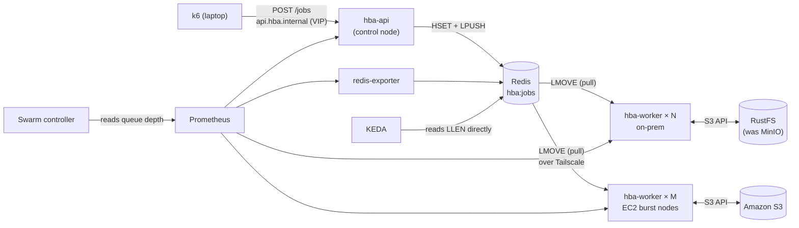

# C# Workload: Design and Contract

**Status:** v1.2, 2026-10-08. First written as a proposal on 2026-09-26; most of it is now **implemented** and merged (PR #25) and runs end to end in the local dev stack. What exists and what is still missing is listed in "Implementation status" below. Since v1.1: MinIO is replaced by **RustFS** (§7.1), the API is reached only over the VPN (§5, §5.6), the images use Docker Hardened Images and run as non-root (§13.1), and the review fixes are folded into §6 and §10. Every decision is still open to challenge; once agreed, each numbered decision becomes an ADR in `docs/decisions/`.

**Audience:** the C# developer building the image-processing service, plus whoever writes the infrastructure around it (Terraform, stacks, autoscaler, k6).

**How to read it:** Sections 1–3 explain *why* the service has to look the way it does. Sections 4–9 are the **contract**, the part both sides build against. Sections 10–12 are rules for worker behaviour that the measurements depend on. Sections 13–16 cover the practical side: containers, testing, schedule, open questions.

Most decisions follow the same pattern: **Decision** → **Why** → **Rejected alternatives**. The reasoning is written out on purpose. If a reason turns out to be wrong, the decision should change, and the reasoning shows what to check.

**Implementation status (2026-10-08):**

| Area | State |
|---|---|
| `Hba.Contracts`, `Hba.Processing`, `Hba.Worker` | implemented, reviewed, merged (PR #25) |
| `Hba.Api`: `POST /jobs`, `GET /jobs/{id}`, `/healthz/*` | implemented, merged |
| `Hba.Api`: token auth (§5.6), `/metrics` (§8.2), `POST /jobs/batch` (§5.2) | **not yet** |
| Local dev stack (`app/docker-compose.dev.yml`, §14.1) | implemented; small/medium/large jobs reach `done` |
| CI builds and pushes the **worker** image (§13.3) | on branch `ci/worker-image`, not merged yet |
| Worker S3 client timeouts | **not yet** (a hung download keeps its heartbeat alive, so the reaper never reclaims it) |
| Integration tests incl. the shutdown test (§14.2) | **not yet** |
| Preset calibration (§10.2) | **not yet** (needs real photos on a 1-CPU worker VM) |
| Worker on the Swarm cluster | **not yet** (needs the worker image, RustFS on `obs-01`, the stack entry; see [app.md](app.md) §5) |

How the pieces interact at runtime, with diagrams: [docs/app.md](app.md).

---

## 1. Why this document exists

The project needs a CPU-heavy, queue-driven workload so it can compare how Docker Swarm and Kubernetes autoscale it, and how the system behaves when it bursts from on-prem hardware into AWS. The workload was first planned in Python (FastAPI and Pillow). It is now being written in C#.

The workload is not the thing being studied. It is **the load the measurements run on**. So the C# code carries some requirements that look odd for a normal service. For example: never cache results, never process two jobs at once, and keep every job equally expensive. Each of these rules comes from something the report measures. This document turns those measurement needs into concrete requirements for the code.

## 2. Project context in five minutes

**Thesis.** Compare Swarm (with a hand-rolled Python autoscaling controller) and Kubernetes (with KEDA) as they autoscale the same queue-driven workload. The setup is a **cloud-bursting** architecture: baseline load runs on one on-prem host, and extra EC2 worker nodes join the cluster only when on-prem capacity runs out.

**Scale of the setup:**

- On-prem: 3 worker VMs × 2 vCPU. That means roughly **6 busy worker replicas** before the host saturates, which is the "plateau".
- AWS: `c6a.large` burst workers (2 vCPU / 4 GiB). They join the *same* cluster over a Tailscale site-to-site link between the lab and the VPC; the burst nodes themselves don't run Tailscale ([network.md](network.md) §2).
- The k6 load generator runs outside the cluster, on the author's laptop on the tailnet ([ADR 0008](adrs/0008-run-k6-from-the-laptop-not-an-aws-host.md); an AWS instance was planned and dropped), and sends HTTP requests to `api.hba.internal`, the cluster's floating VIP ([cluster-vip.md](cluster-vip.md)). There is no public ingress: the services are reachable only inside the tailnet and the VPC.

**What gets measured, and which part of the C# code produces it:**

| Measurement in the report | Produced by |
|---|---|
| Queue depth over time | Redis list length (read by redis-exporter and KEDA; not by C# code) |
| Replica count over time | the orchestrator (not by C# code) |
| Throughput (jobs completed per second) | worker: `hba_jobs_completed_total` |
| Time a job waits in the queue | worker: `hba_job_queue_wait_seconds` |
| Job duration per tier (on-prem vs AWS) | worker: `hba_job_duration_seconds{tier}` |
| API acceptance latency | k6 (client side) and the API's HTTP metrics |

The key result is the shape of these curves. The queue grows, replicas climb to the on-prem plateau, burst nodes join, throughput lifts, and the queue drains. Anything in the worker that makes job cost unpredictable adds noise to exactly those curves.



## 3. Core principle: REST is the entry point, the queue carries the work

**Decision 1.** The system is split in two. A thin REST API **accepts** jobs and puts them on a Redis queue. Separate worker processes **pull** jobs from the queue and do the image processing. Workers expose no business endpoints.

**Why:**

1. **The autoscaling signal is the queue length.** The Swarm controller and KEDA both scale workers on the number of jobs waiting in Redis. If the API processed images synchronously, the queue would always be empty. Both autoscalers would see zero load and never scale. The only remaining option would be CPU-based scaling (HPA), which this project deliberately does not use.
2. **The pull model is what makes the AWS burst tier work.** A worker only makes *outbound* connections, to Redis and to storage. It needs no inbound route, no load-balancer entry and no public address. A burst node that joined over Tailscale can start taking jobs as soon as it runs a container. With a push model, the ingress would have to learn about burst nodes and send HTTP traffic across the WAN link.
3. **The queue absorbs spikes, and that is what gets measured.** When load goes past capacity, a synchronous design fails with timeouts and 5xx errors. A queue-based design shows a **growing backlog**, which is the plateau the report is about. Timeouts would measure HTTP client settings, not autoscaling.
4. **k6 measures what we mean it to measure.** With a queue, k6's request latency is the cost of *accepting* a job, a few milliseconds. The cost of *processing* shows up separately in the worker metrics. A synchronous design mixes the two together.

**Rejected alternatives:**

- *A synchronous REST worker behind a load balancer.* Explained above: no queue signal, and it only fits CPU/HPA scaling.
- *The API pushing to workers over HTTP or gRPC.* The API would need a list of workers (service discovery across tiers) and inbound connectivity to burst nodes. It also gives up the backlog as a signal.
- *RabbitMQ or another dedicated broker.* KEDA supports it, but it adds a component. Redis is already in the design, and redis-exporter already provides the metric the Swarm controller needs.
- *Redis Streams instead of a list.* This one was genuinely tempting, because consumer groups give you built-in acknowledgements and a pending-entries list for free. It was rejected because **both autoscalers must read exactly the same signal**, or the comparison is contaminated. With a list, the signal is `LLEN`: one number that means "jobs waiting" in KEDA, in redis-exporter and in the Swarm controller. With a stream, `XLEN` doesn't go down when a job is acknowledged, so the right signal becomes consumer-group lag or pending count. That is subtler, and the risk is that KEDA and the exporter end up computing slightly different numbers. The reliability that Streams would give is rebuilt by hand in §6.5, with about 10 lines of Lua.

## 4. Architecture of the C# side

### 4.1 Two deployables

**Decision 2.** There are two container images, `hba-api` and `hba-worker`, built from one .NET solution. **Both are written in C#** *(proposed; see §16, Open decision A)*.

**Why two processes and not one binary with two modes:**

- They scale separately. `hba-api` runs as **one replica on the control node**. `hba-worker` runs as **N replicas on worker nodes**, and N is the number the autoscalers change.
- The report states that the control node "runs no job replicas". The API must never use the CPU that workers are measured on.
- The API image stays small and never contains image-processing code (see the dependency rules below). That makes it impossible to process an image in the API by accident.

**Why the API is in C# too (not FastAPI):** the API and the worker share the job message format. If both reference one `Hba.Contracts` project, a field rename becomes a compile error instead of a runtime bug found in the middle of a load test. The API is about 150 lines either way, so the language choice costs little and removes a whole class of mistakes. The only Python in the project stays the Swarm autoscaler controller, which never parses job messages.

### 4.2 Solution layout

Entries marked *(planned)* don't exist in the repo yet.

```
app/
  hba.slnx                       # solution file (the newer XML .slnx format)
  Directory.Build.props          # (planned) shared: TargetFramework net10.0, Nullable, TreatWarningsAsErrors
  contracts/
    job-message.example.json     # canonical sample message; used by the contract test and k6
  src/
    Hba.Contracts/               # job message, Redis key and hash field names, status values, preset names (not their settings)
    Hba.Processing/              # pure image logic: bytes in → bytes out. No Redis, no S3, no HTTP
    Hba.Worker/                  # queue loop, storage I/O, heartbeat, reaper, metrics, health, warm-up
    Hba.Api/                     # ASP.NET Core API with controllers: validate → enqueue → return 202
  tests/
    Hba.Api.Tests/               # endpoint tests against a fake queue (WebApplicationFactory)
    Hba.Processing.Tests/        # pipeline and preset tests (fast, no containers)
    Hba.Worker.Tests/            # contract tests, worker settings, reaper rules
    Hba.IntegrationTests/        # (planned) Testcontainers: Redis + RustFS, end-to-end
  dev-images/                    # local photos for the dev stack; git-ignored
  Dockerfile.api
  Dockerfile.worker
  docker-compose.dev.yml         # local stack: redis, rustfs, api, worker (§14.1)
  worker.md                      # worker settings reference
```

**Dependency rules** (enforce them in code review, or add an architecture test later):

| Project | May reference | Must not reference |
|---|---|---|
| `Hba.Contracts` | nothing (BCL only) | anything else |
| `Hba.Processing` | ImageSharp | Redis, S3, ASP.NET, Contracts |
| `Hba.Worker` | Contracts, Processing, Redis, S3, prometheus-net | Api |
| `Hba.Api` | Contracts, Redis, prometheus-net | **Processing**, S3 |

**Why `Hba.Processing` is kept pure:** this is the C# developer's core code, and it can be unit-tested and benchmarked on its own with nothing else running. It is also the only part whose speed the report cares about, so keeping I/O out of it lets the worker time the CPU part precisely (§8, the `process` stage).

**Naming exception:** [CONTRIBUTING.md](../CONTRIBUTING.md) requires lowercase kebab-case files and directories. .NET projects follow PascalCase by strong convention, and tools expect it (namespaces, assembly names). Proposal: **`app/src/` and `app/tests/` are exempt**, and everything else under `app/` stays kebab-case. This is to be added to CONTRIBUTING.

### 4.3 Technology stack

| Concern | Choice | Why |
|---|---|---|
| Runtime | **.NET 10 (LTS)** | Supported until Nov 2028. .NET 8 LTS support ends on **10 Nov 2026**, just before the project deadline, so starting on it would mean running out of support while writing the report. |
| API | ASP.NET Core with controllers (`AddControllers()`) | Already used by the first working API. Built-in ProblemDetails, model validation and health checks. The OpenAPI document (`/openapi/v1.json`) and the Scalar UI (`/scalar`) are mapped **only in Development**, so they never reach the cluster. |
| Worker host | `WebApplication` + `BackgroundService` | The worker still needs HTTP for `/metrics` and `/healthz`. Hosting the loop in a `WebApplication` gives both, plus clean SIGTERM handling. |
| Redis client | StackExchange.Redis | The standard .NET client. Note that it doesn't support blocking pops (§6.4). |
| Object storage | AWSSDK.S3 | Works against both RustFS (on-prem, S3-compatible) and Amazon S3 (§7), so one code path serves both tiers. |
| Metrics | prometheus-net + prometheus-net.AspNetCore | Standard Prometheus text endpoint and HTTP request metrics. |
| Image processing | SixLabors.ImageSharp | Fully managed code. §11 covers the reasoning and the licence. |
| JSON | System.Text.Json, `[JsonPropertyName]` per property | See §6.2. |
| Tests | xUnit; `WebApplicationFactory` for the API; Testcontainers for .NET planned for integration tests | §14 |

## 5. Contract 1: the REST API (`hba-api`)

All endpoints listen on port **8080**, the default for ASP.NET Core container images. Clients reach it as `api.hba.internal:8080`: a name for the cluster's floating VIP, resolvable only inside the tailnet and the VPC ([cluster-vip.md](cluster-vip.md)). On Swarm the port is published today; routing by host name through an ingress (Traefik on Swarm, the ingress controller on Kubernetes) is planned. The API sets no path prefix.

### 5.1 `POST /jobs`: submit one job

Request:

```json
{ "input_key": "src/img-04.jpg", "preset": "medium" }
```

| Field | Type | Rule |
|---|---|---|
| `input_key` | string | must match `^src/[a-z0-9-]+\.(jpg\|jpeg\|png)$` |
| `preset` | string | one of the preset names (§10.2) |

Response **202 Accepted**, with the header `Location: /jobs/{job_id}`:

```json
{ "job_id": "0192f3c4-8a1e-7cc0-b1f2-3d4e5f607182", "status": "queued" }
```

**Why 202 and not 200 or 201:** 202 means "accepted for processing, not finished", which is exactly what happened. The client polls the `Location` URL for the result.

**Why the request names a preset and not free-form parameters** (width, quality and so on): see §10.2. In short, a job's cost has to be reproducible from its name, so the k6 script and the report refer to the same fixed presets.

**Why the request refers to a key and doesn't carry the image:** during a load test k6 can send hundreds of requests per second across the tailnet from outside the cluster. If each request carried a 5 MB image, the home internet uplink would become the bottleneck, and the test would measure upload bandwidth, not autoscaling. The source images are loaded into storage once, before the test (§7.4).

**Why the API doesn't check that `input_key` exists:** that would cost one storage round-trip per request, make the API depend on storage, and slow down the one step that must stay cheap. If the object is missing, the worker marks the job `failed` (§10.4). The regex rules out paths outside the source set.

### 5.2 `POST /jobs/batch`: submit many identical jobs *(should have; not implemented yet)*

```json
{ "input_key": "src/img-04.jpg", "preset": "medium", "count": 200 }
```

`count` is 1–1000. The response is **202** with `{ "job_ids": [...], "count": 200 }`. It uses one pipelined Redis transaction.

**Why:** the planned presentation includes a live moment: "submit a burst of jobs and watch the queue spike in Grafana". One `curl` is more reliable on stage than a k6 run. It is also useful for manual testing. k6 load tests should still use `POST /jobs`, so each request is one job and the request rate equals the job arrival rate.

### 5.3 `GET /jobs/{job_id}`: job status

**200** with:

```json
{
  "job_id": "0192f3c4-...",
  "status": "done",
  "preset": "medium",
  "input_key": "src/img-04.jpg",
  "output_store": "rustfs",
  "output_key": "out/0192f3c4-....webp",
  "tier": "onprem",
  "worker": "swarm-02",
  "attempts": 1,
  "submitted_at": "2026-10-12T14:03:11.4020000+00:00",
  "started_at": "2026-10-12T14:03:15.0200000+00:00",
  "finished_at": "2026-10-12T14:03:17.6110000+00:00",
  "error": null
}
```

`output_store` is `rustfs` for on-prem jobs and `s3` for burst jobs (§7.2). Timestamps are written by `JobHash.FormatTimestamp` (UTC, round-trip format). Fields a job hasn't reached yet are `null`. The response is **404** if the ID is unknown or the record has expired (24 h TTL, §6.1).

### 5.4 Operational endpoints

| Endpoint | Purpose |
|---|---|
| `GET /healthz/live` | the process is running (§8.4) |
| `GET /healthz/ready` | Redis is reachable (§8.4) |
| `GET /metrics` | Prometheus scrape (§8); **worker only so far**, not yet in the API |

### 5.5 Errors

All errors use **RFC 9457 Problem Details** (`application/problem+json`, set up with `AddProblemDetails()`):

| Status | When |
|---|---|
| 400 | failed validation (bad `input_key`, unknown preset, `count` out of range) |
| 401 | missing or wrong API token (§5.6) |
| 404 | unknown job |
| 503 | Redis unreachable, **or** the queue is over `HBA_MAX_QUEUE_LENGTH` (header `Retry-After: 5`) |

**Why there is a queue cap at all, when a growing queue is the point:** a mistaken k6 script could otherwise fill Redis until it runs out of memory on the control node (4 GB, shared with the manager or control plane). One queued job takes about 0.5 KB (message plus status hash), so the default cap of 50,000 jobs is about 25 MB, far above any planned test and far below the danger zone. A k6 run should never reach the cap. If one does, the 503s show up in k6's error rate and are easy to spot.

### 5.6 Authentication

**Changed since v1.1:** the API was going to be reachable from the internet through OPNsense, with an allowlist for the k6 instance's Elastic IP. The project has since moved to **VPN-only access**: no public domain, no public ingress; k6 reaches `api.hba.internal` over Tailscale from the laptop ([cluster-vip.md](cluster-vip.md), [ADR 0008](adrs/0008-run-k6-from-the-laptop-not-an-aws-host.md)). **Decision 3** keeps two cheap layers:

1. **Network:** the API is reachable only from inside the tailnet and the VPC. Tailscale grants can narrow this further (for example, only the k6 subnet) when the site-to-site link is built.
2. **Token** *(not implemented; dropped on 2026-10-23: the network layer alone is the access control, and a token adds nothing for a VPN-only lab API)*: the API would have required `Authorization: Bearer <HBA_API_TOKEN>` on `POST` endpoints. The token is a GitHub/Swarm/Kubernetes secret. `GET /healthz/*` and `/metrics` need no token.

**Why not something stronger:** there is no user data here. The only risk is someone submitting jobs, which would spoil a test run and use CPU. A static token plus a source-IP allowlist is proportionate. OAuth or mTLS would be out of scope.

## 6. Contract 2: Redis queue and job state

### 6.1 Keys

| Key | Type | Written by | Read by | TTL |
|---|---|---|---|---|
| `hba:jobs` | list | API (`LPUSH`), reaper (`RPUSH`) | worker (`LMOVE`), **KEDA, redis-exporter** | none |
| `hba:jobs:processing` | list | worker (`LMOVE` in, `LREM` out) | reaper | none |
| `hba:job:{job_id}` | hash | API (create), worker (update) | API (`GET /jobs/{id}`) | 24 h |

**Do not rename `hba:jobs` casually.** It is referenced outside the C# code: in the KEDA `ScaledObject` (`listName`), in the redis-exporter configuration (`--check-single-keys`), and in the Swarm controller's Prometheus query. The key names live in `Hba.Contracts` as constants, and any change needs a PR that updates all four places.

**Why the 24 h TTL on status hashes:** one test run can create tens of thousands of jobs. Without a TTL, Redis memory would grow with every run on a node that has little memory to spare. 24 hours is long enough to inspect a run afterwards. The results that matter are in Prometheus, not Redis. The value is a constant (`JobHash.Ttl` in `Hba.Contracts`), not a setting: the API, the worker and the reaper all set it, and a per-service setting could make them disagree.

### 6.2 Queue message

This is the value pushed onto `hba:jobs`, a UTF-8 JSON string:

```json
{
  "schema_version": 1,
  "job_id": "0192f3c4-8a1e-7cc0-b1f2-3d4e5f607182",
  "input_key": "src/img-04.jpg",
  "preset": "medium",
  "submitted_at": "2026-10-12T14:03:11.402+00:00"
}
```

- **Built only by `JobMessage.Create()` and written only by `ToJson()`.** The API never assembles the JSON by hand. `Parse()` uses the same serializer options, and a missing or `null` field is rejected instead of turning into a default value.
- **`job_id`: UUIDv7** from `Guid.CreateVersion7(submitted_at)`. It is time-ordered, so IDs sort by submission time in logs and in storage listings, which makes it easier to follow a run afterwards.
- **`schema_version`:** lets a worker reject a message it doesn't understand, instead of misreading it, if the API and worker images are ever deployed out of step. The worker marks such a job `failed` in its hash rather than dropping it silently.
- **`submitted_at`:** set by the API, always UTC. The worker uses it to compute queue wait time (§8.1). The format is System.Text.Json's default (`+00:00`, not `Z`), kept as is rather than adding a custom converter.
- **snake_case field names:** the same JSON is read or written by k6 (JavaScript), and the rest of the project (Python controller, Prometheus) uses snake_case. A `[JsonPropertyName]` attribute on each property keeps the C# properties in PascalCase and makes the wire name explicit, so renaming a C# property can't change the JSON.
- The message is **deliberately small and immutable**. State that changes (status, attempts, timings) lives in the hash, never in the message. The reliability pattern in §6.5 removes messages by their exact byte value, so a message must never be rewritten while it is in a list. The worker keeps the raw bytes it popped and never re-serialises a message.

`app/contracts/job-message.example.json` holds the canonical example. A contract test parses it, writes it back and checks that the JSON is unchanged. The k6 script builds its request body from the same fields.

The hash field names (`JobHash`), status values (`JobStatus`), output-store values (`OutputStores`), preset names (`PresetNames`) and the `input_key` pattern (`JobMessage.InputKeyPattern`) are constants in `Hba.Contracts` too. The worker's Lua scripts are built from these constants, so a renamed field is changed everywhere at once.

### 6.3 Job lifecycle

```
API:     MULTI
           HSET hba:job:{id} status=queued input_key=… preset=… submitted_at=… attempts=0
           EXPIRE hba:job:{id} 86400
           LPUSH hba:jobs <message>
         EXEC
Worker:  LMOVE hba:jobs hba:jobs:processing RIGHT LEFT      → <message>
         MULTI
           HSET hba:job:{id} status=processing started_at=… worker=… tier=… heartbeat_at=…
           EXPIRE hba:job:{id} 86400
           HINCRBY hba:job:{id} attempts 1
         EXEC
         … download → process → upload …   (heartbeat_at refreshed every 5 s)
         EVAL (one Lua script, atomic):
           LREM hba:jobs:processing 1 <message>
           only if that removed it: HSET hba:job:{id} status=done finished_at=… output_store=… output_key=…
```

- **The status hash is written before the message is pushed, in one transaction.** Otherwise a fast worker could take a job whose hash doesn't exist yet.
- **`LPUSH` + pop from the RIGHT = FIFO.** Jobs are processed in arrival order, so "queue wait time" means the same thing for every job, and no job waits forever while newer ones overtake it.
- **The worker removes the message from `processing` only after the output is uploaded, and in the same atomic step that sets the final status.** If the worker dies at any earlier point, the message is still in `processing` and can be recovered (§6.5). If the message is already gone (the reaper took the job back meanwhile), the status is not written and the result is discarded: another attempt owns the job now.

### 6.4 How the worker waits for jobs: polling, not blocking

StackExchange.Redis multiplexes all commands over shared connections. For that reason it **does not support blocking commands** such as `BLMOVE` or `BRPOP`: one blocked command would stall every other command on the connection.

**Decision 4.** The worker calls the non-blocking `LMOVE` (`IDatabase.ListMoveAsync`). If the queue is empty, it waits and tries again with backoff: 50 ms, doubling, capped at `HBA_IDLE_POLL_MAX_MS` (default 500 ms). The delay resets as soon as a job is found.

**Why this is fine:**

- A job takes about 2–5 s (§10.2). Up to 0.5 s of idle pickup delay only applies when the queue was *empty*, which is exactly when nobody is waiting.
- Cost: 20 idle replicas × at most 20 polls/s is 400 cheap commands per second. That is noise for Redis. With KEDA scale-to-zero, idle replicas don't even exist.
- While the queue is non-empty, the worker never sleeps. It calls `LMOVE` again right after each job.

**Rejected alternatives:** sending `BLMOVE` through `ExecuteAsync` on a dedicated connection (it works, but goes against the library's design, and timeouts interact badly with the multiplexer's own timeouts), or pub/sub notifications with `LMOVE` (more moving parts to save a delay nobody notices).

### 6.5 Reliability: at-least-once, with a reaper

Workers get killed: scale-down, a burst node torn down, SIGKILL after the grace period. A message moved into `hba:jobs:processing` by a worker that then died would otherwise stay there forever. The job would be lost, and the report's throughput numbers would be quietly wrong.

**Decision 5.** Recovery uses a heartbeat and a **reaper** *(implemented)*:

- While a job is being processed, the worker updates `heartbeat_at` in the job's hash every 5 s.
- Every 30 s, each worker runs the reaper. It reads `hba:jobs:processing` (`LRANGE`), and for every message whose job's `heartbeat_at` is older than 60 s, **or missing on two consecutive passes**, it runs this Lua script atomically. A single missing heartbeat is not enough: between the worker's `LMOVE` and its first `HSET` a freshly claimed job has no heartbeat for one round trip, which is longer on burst nodes, and reaping it then would process it twice. The worker uses the same script (`JobScripts.Requeue`) for its own retries; it also resets the hash's TTL:

```lua
-- KEYS[1] = hba:jobs:processing, KEYS[2] = hba:jobs, ARGV[1] = exact message bytes
-- (simplified: the real script, JobScripts.cs, also resets the job's hash to status=queued,
--  clears the previous attempt's fields and refreshes the 24 h TTL)
if redis.call('LREM', KEYS[1], 1, ARGV[1]) == 1 then
  redis.call('RPUSH', KEYS[2], ARGV[1])   -- RIGHT end = next to be popped: recovered jobs go first
  return 1
end
return 0
```

- **Why Lua:** `LREM` followed by `RPUSH` as two separate commands leaves a gap. A reaper that crashes between them loses the job. A Lua script runs atomically inside Redis.
- **Why it's safe with many reapers:** only one `LREM` can return 1 for a given message. Every other reaper gets 0 and does nothing. No leader election is needed.
- **Why `RPUSH` (front of the queue):** the recovered job has already waited the longest. Putting it at the back would add a second full queue wait and create an outlier in the queue-wait histogram.

**Consequence: jobs can run twice.** This is *at-least-once* delivery, so the worker must be **idempotent**. The output key is fixed by the job ID (`out/{job_id}.{ext}`), so running a job again overwrites the same object instead of creating a second one. The counter `hba_jobs_completed_total` may count a recovered job twice. Because `attempts` is recorded, duplicates can be counted and reported if they ever matter.

**Identical copies.** Messages are removed by their exact bytes, so two copies of the same job in flight (after a reaper recovery) can't be told apart: whichever worker finishes first removes one copy and records the result. The other worker's completion then finds no copy left, logs that the job was taken back, and discards its result. The two-pass rule above makes this rare.

**Poison jobs.** An attempt that ends in a worker crash is only counted when the job is next claimed (`HINCRBY attempts`). A claim that finds `attempts` above 3 marks the job `failed` without processing it, so a job that kills its worker can't be retried forever.

### 6.6 Known limitation: jobs in progress are invisible to the autoscalers

KEDA and the Swarm controller both scale on `LLEN hba:jobs`, the *waiting* jobs only. Jobs sitting in `hba:jobs:processing` are not counted. When the queue drains, both autoscalers may decide to scale down **while replicas are still in the middle of a job**. The worker is designed for this (graceful shutdown, §10.3), and both autoscalers have cooldowns. It is still a real property of queue-length scaling and should be stated as a finding in the report, not hidden. The possible fix (scaling on waiting + in-flight jobs) is noted, not implemented: KEDA's Redis scaler reads one list per trigger, and multiple triggers are combined with *max*, not *sum*.

## 7. Contract 3: object storage

### 7.1 One SDK, two backends

The worker uses **AWSSDK.S3** for both stores:

| Tier | Store | Client setup |
|---|---|---|
| on-prem | **RustFS** (S3-compatible) | `ServiceURL = HBA_S3_ENDPOINT_ONPREM`, `ForcePathStyle = true`, static access key (secret) |
| aws | Amazon S3 | `RegionEndpoint = HBA_S3_REGION`, credentials from the **EC2 instance profile** (no static keys) |

The AWS SDK's default credential chain picks up the instance profile on its own. No AWS keys are ever placed on burst nodes.

**Changed since v1.1: RustFS instead of MinIO.** On 2026-10-08 the MinIO server and client images (`minio/minio`, `minio/mc`) were no longer on Docker Hub (the repositories return 404), and `quay.io/minio/*` refused anonymous pulls. Building MinIO from source would add an image to maintain for a part of the system the project doesn't measure. RustFS (`rustfs/rustfs`, Apache-2.0) was chosen over Garage and SeaweedFS as the closest drop-in: one container, S3 API plus a web console, configured with environment variables. The worker needed no code change, only a different endpoint and keys; uploads with the AWS SDK's default checksums work against it (tested locally). Garage remains the fallback if RustFS, a young project, causes trouble. An ADR records this.

### 7.2 Storage follows the worker

**Decision 6** *(proposed; see §16, Open decision B)*. Each worker reads from and writes to **the store in its own tier**. On-prem workers use RustFS, burst workers use S3. Both stores hold an identical copy of the source image set. The job hash records `output_store` (`rustfs` or `s3`) next to `output_key`.

**Why:** consider the alternatives with real numbers.

- *Everything in the on-prem store:* burst workers would download every source image from on-prem **through the home internet uplink**. 10 burst replicas × one 5 MB image every 3 s ≈ **130 Mbit/s** of upload, plus the outputs going back. That is more than a typical home uplink. The burst tier would be limited by the network, and the test would measure the ISP instead of autoscaling.
- *Everything in S3:* on-prem workers would download from S3, and **S3 charges for data transferred out to the internet** (about $0.09/GB). 6 replicas × 5 MB every 3 s over a 30-minute run ≈ 18 GB ≈ **$1.60 per run**, and the on-prem store would no longer get any real use. The project plan explicitly wants both storage backends used for real.
- *Storage follows the worker:* all image data moves over local paths (LAN for on-prem, in-region for AWS, which is free). Only small Redis messages cross the Tailscale link. This is the storage version of the reason the workload is pull-based in the first place.

**Trade-off accepted:** output images are split across two stores. Nothing downstream uses the outputs, since they are the product of a benchmark, not of a real service. So this costs nothing in practice.

**Infrastructure notes (not C# work, but the C# side depends on them):** the VPC needs an **S3 gateway endpoint** (free, and it keeps S3 traffic off any NAT). The bucket needs a lifecycle rule that expires `out/` after 7 days.

### 7.3 Bucket and key layout

- **One bucket per store** (named by `HBA_S3_BUCKET`). The name is configurable because S3 bucket names are globally unique.
- `src/{name}.jpg`: source images, read-only for workers.
- `out/{job_id}.{ext}`: outputs, one object per job, overwritten if the job is retried (§6.5).

### 7.4 The source image set

- **8–12 photographs, 12–24 MP JPEG, taken by one of us.** Owning the copyright means they can sit in a public bucket and a public repo without licence questions. Stock photos and web images cannot.
- **Real photos, not generated ones.** Encoder and resampler cost depends on image content (detail, noise, edges). Synthetic gradients or noise would give unrealistic costs.
- **Versioned and not stored in git.** The set goes into a GitHub Release asset (`source-set-v1.tar`). A seed script uploads it to both RustFS and S3. The set version is recorded with every test run, so results can be reproduced.
- **Strip the metadata before publishing.** Phone and camera photos often carry GPS coordinates in their EXIF data; run `exiftool -all=` on the set before it goes into the public Release. (The pipeline itself drops metadata on decode, §11.5, but that only protects the outputs.)
- **Only JPEG and PNG.** The pipeline decodes nothing else (§11.5).
- **Warm-up image:** the worker generates a 1024×1024 sample in memory for warm-up (§10.5), with no storage dependency. *(The design called for an embedded real photo; see §10.5.)*

## 8. Contract 4: metrics, health and logging

Metric names follow the `hba_` prefix convention from [CONTRIBUTING.md](../CONTRIBUTING.md).

### 8.1 Worker metrics

| Metric | Type | Labels | Meaning / consumer |
|---|---|---|---|
| `hba_jobs_completed_total` | counter | `tier`, `preset`, `status` (`done`/`failed`) | throughput graph; `rate()` gives jobs/s |
| `hba_job_duration_seconds` | histogram | `tier`, `preset` | time from `started_at` to `finished_at` inside the worker, **successful jobs only** (the metric has no `status` label, so fast failures and retried attempts would skew it); the per-tier comparison in §5 of the report |
| `hba_job_stage_seconds` | histogram | `tier`, `stage` (`download`/`process`/`upload`) | splits the duration into CPU time and I/O time |
| `hba_job_queue_wait_seconds` | histogram | `tier` | `started_at − submitted_at`, first attempt only; shows what bursting buys the user. Compares the API host's clock with the worker node's, so all nodes need NTP; a negative value is logged as clock skew |
| `hba_jobs_in_progress` | gauge | `tier` | 0 or 1 per replica; summing it gives busy replicas |
| `hba_worker_warmup_seconds` | gauge | `tier` | design: time from process start to taking the first job (§10.5). *Implemented today: only the duration of the warm-up runs themselves; to be aligned in review phase 6* |
| `hba_worker_info` | gauge (always 1) | `tier`, `version`, `avx2`, `avx512`, `vector_bits`, `processor_count` | proves CPU parity from inside the runtime (§12) |

**Why the `process` stage is separated:** the report compares on-prem and AWS speed on the assumption that the CPU work is the same (§12). `download` and `upload` differ by tier *by design* (different stores). Only `process` is a clean CPU comparison. Without the split, a slow storage disk would look like a slow CPU.

**Histogram buckets.** Don't use prometheus-net's defaults. Those are tuned for web latency (5 ms – 10 s). `histogram_quantile()` is only accurate if there are buckets near the values being measured:

- `hba_job_duration_seconds`, `hba_job_stage_seconds`: `0.1, 0.25, 0.5, 1, 1.5, 2, 2.5, 3, 4, 5, 6, 8, 10, 15, 30`
- `hba_job_queue_wait_seconds`: `0.1, 0.5, 1, 2, 5, 10, 20, 30, 60, 120, 300, 600`. Queue waits during saturation can run to minutes, and that range is the finding.

**The cardinality rule:** labels only take values from small fixed sets. **Never** use `job_id`, `input_key` or timestamps as labels. Each distinct value creates a new time series, and a load test would create tens of thousands.

**Where `tier` comes from:** it is resolved once at startup (§9.2) and put on every worker metric.

### 8.2 API metrics *(not implemented yet)*

| Metric | Type | Labels |
|---|---|---|
| `hba_jobs_submitted_total` | counter | `preset` |
| `hba_api_rejected_total` | counter | `reason` (`validation`/`auth`/`queue_full`/`redis_down`) |
| `http_request_duration_seconds` | histogram | from `UseHttpMetrics()` |

**The API does not export queue length.** redis-exporter already exports it (`redis_key_size{key="hba:jobs"}`). With a second copy, dashboards and the Swarm controller could end up reading different series. One signal, one source.

### 8.3 Runtime metrics

prometheus-net exports .NET runtime metrics by default (GC collections, heap size, thread pool, process CPU). Keep them on. If a result looks odd, GC pauses under memory pressure are one of the first things to rule out.

### 8.4 Health endpoints

| Endpoint | API | Worker | Used by |
|---|---|---|---|
| `/healthz/live` | process responds | process responds | Swarm `HEALTHCHECK`, Kubernetes `livenessProbe` |
| `/healthz/ready` | Redis `PING` succeeds | warm-up done **and** Redis `PING` succeeds | Kubernetes `readinessProbe`, Grafana |

**Why liveness never checks Redis:** if liveness depended on Redis, one Redis restart would fail every worker's liveness check, and the orchestrator would restart the whole fleet at the same moment. That turns a brief Redis outage into a mass restart, which would show up in the data as an orchestrator event. Liveness only answers "is this process stuck?"

**Health checks without curl:** the hardened .NET runtime images have no shell, `curl` or `wget`, and Docker's `HEALTHCHECK` needs a command inside the container. The worker supports a **`--healthcheck` argument**: the binary calls `http://localhost:8080/healthz/live` and exits 0 or 1. `Dockerfile.worker` uses `HEALTHCHECK CMD ["dotnet", "Hba.Worker.dll", "--healthcheck"]`. This is simpler and smaller than adding a package to the image. (The API has no `--healthcheck` mode or `HEALTHCHECK` yet.)

**Open: should the worker be health-checked during measurement runs?** Each check starts a whole new .NET process inside the 1-CPU worker container every 30 s, which takes CPU from the job being measured. **Kubernetes ignores Docker `HEALTHCHECK`** and uses its own HTTP probes, so only Swarm pays this cost, which would make the comparison slightly unequal. The check also catches little: a crashed worker exits and is restarted anyway, and `/healthz/live` still answers while the job loop is stuck. Recommendation: `healthcheck: disable: true` for the worker in the Swarm stack, and no `livenessProbe` for the worker on Kubernetes, so both run it under the same conditions; keep the `HEALTHCHECK` in the Dockerfile for local use. See §16.1, decision I.

### 8.5 Logging

- **Structured JSON to stdout** (`AddJsonConsole()`), one line per event. Docker and Kubernetes collect stdout by default. No log shipping is in scope.
- **One summary line per finished job**, with `job_id`, `preset`, `tier`, `status`, `attempts`, and the three stage durations. With it, one odd job can be looked up after a run, without adding high-cardinality metrics.
- Log level comes from the standard `Logging__LogLevel__Default` environment variable. The default is `Information`. Don't log every poll of an empty queue.

## 9. Configuration

### 9.1 Environment variables

All project-specific settings use the prefix `HBA_`. It makes them easy to grep for in stack files and keeps them clear of the .NET and ASP.NET variable names.

| Variable | Used by | Default | Notes |
|---|---|---|---|
| `HBA_REDIS` | api, worker | `redis:6379` | StackExchange.Redis configuration string |
| `HBA_TIER` | worker | `auto` | `onprem` \| `aws` \| `auto` (§9.2) |
| `HBA_NODE_NAME` | worker | *(unset)* | set by the orchestrator, used by `auto` (§9.2) |
| `HBA_S3_BUCKET` | worker | none (required) | |
| `HBA_S3_ENDPOINT_ONPREM` | worker | none (required on-prem) | RustFS URL. On the cluster, RustFS runs on `obs-01` outside the swarm, so this is a lab address (`http://<obs-01>:9000`); `http://rustfs:9000` only works in the local compose stack |
| `HBA_S3_ACCESS_KEY`, `HBA_S3_SECRET_KEY` | worker | *(unset)* | RustFS only; delivered as orchestrator secrets. Each also accepts a `_FILE` variant (`HBA_S3_SECRET_KEY_FILE=/run/secrets/…`), because Swarm delivers secrets only as files, never as environment variables |
| `HBA_S3_REGION` | worker | `eu-central-1` | checked against the AWS SDK's list of known regions (`GetBySystemName` alone accepts any name) |
| `HBA_API_TOKEN` | api | none (required) | §5.6; *not implemented yet* |
| `HBA_MAX_QUEUE_LENGTH` | api | `50000` | §5.5 |
| `HBA_IDLE_POLL_MAX_MS` | worker | `500` | §6.4 |
| `HBA_WARMUP_ITERATIONS` | worker | `3` | `0` turns warm-up off (§10.5) |
| `HBA_SHUTDOWN_TIMEOUT_SECONDS` | worker | `25` | must be 1–29, below the 30 s grace period (§10.3). The API uses the .NET default and needs no setting: it holds no work across a restart |

**Required settings fail fast.** At startup, the app validates its settings and exits with a one-line message and exit code 1 if something required is missing or invalid. A worker that starts, takes a job and *then* finds it has no bucket name turns into a crash loop in the middle of a test.

### 9.2 Working out the tier

The worker has to know whether it runs on-prem or on AWS, for the `tier` label and to choose a store. The difficulty: there is **one** worker service (Swarm) or Deployment (Kubernetes), and the scheduler places its replicas on burst nodes when they join. Both tiers therefore get the same container spec, including the same environment.

**Decision 7.** The tier is resolved in this order:

1. If `HBA_TIER` is `onprem` or `aws`, use it (a manual override for tests).
2. If it is `auto`, use the **node name**, which the orchestrator passes in as `HBA_NODE_NAME`:
   - Swarm: `HBA_NODE_NAME={{.Node.Hostname}}` (a Swarm service template)
   - Kubernetes: `valueFrom.fieldRef.fieldPath: spec.nodeName` (Downward API)
   - A node name starting with `burst-` means `aws`. Anything else means `onprem`. The naming convention for burst nodes is already in the architecture section of the report (`burst-wN`).
3. If `HBA_NODE_NAME` is missing while `HBA_TIER=auto`, **refuse to start**. An unknown tier would put wrong labels on the per-tier data, and that is worse than a crash.

**Why the node name:** both orchestrators can inject it with one line. It needs no network call, and it can be unit-tested with a string.

**Rejected alternatives:**

- *Asking the EC2 instance metadata service (IMDS) at startup.* It adds a network timeout to every on-prem start (the metadata address doesn't answer on-prem). It also depends on the instance's IMDSv2 hop limit (below).
- *Two worker services or Deployments, one per tier.* The autoscalers would have to choose which one to scale, which changes the design being compared.
- *Node labels passed into the environment.* Swarm templates can't read node labels, and the Kubernetes Downward API doesn't expose them in the usual way.

**Cross-team gotcha, IMDS hop limit:** the AWS SDK gets instance-profile credentials from IMDS. By default IMDSv2 answers only **one network hop** away, and a container on a Docker or Kubernetes bridge network is two hops away, so the SDK silently finds no credentials. Burst instances must be launched with **`HttpPutResponseHopLimit = 2`**. This belongs in the burst-worker launch code (boto3 `MetadataOptions`), but it breaks the C# side if it's missing, so it is listed here.

## 10. Worker behaviour rules

These rules exist because of the measurements. Each rule names the measurement it protects.

### 10.1 One job at a time, one replica ≈ one vCPU

**Decision 8.** A worker replica processes **exactly one job at a time**, and the image processing inside a job is **single-threaded**.

**Why:** the whole scaling model assumes that **one replica is one fixed unit of capacity**.

- The on-prem plateau of "about 6 replicas" is 3 nodes × 2 vCPU ÷ 1 vCPU per replica.
- The Swarm controller computes `replicas = ceil(queue_depth / jobs_per_replica)`, and KEDA's `listLength` target works the same way. Both assume capacity grows linearly with replica count.
- If one replica used every core it could reach (ImageSharp parallelises across `Environment.ProcessorCount` by default), 3 replicas would saturate the cluster. Replicas 4 to 6 would add nothing. The autoscalers would keep adding replicas that add no throughput, and the report would describe a system that doesn't exist.

**Implementation:**

- The worker loop is sequential: take a job, process it, take the next. No `Parallel.ForEach`, no concurrent in-flight jobs.
- ImageSharp is given its own `Configuration` with **`MaxDegreeOfParallelism = 1`**, passed through `DecoderOptions`.
- Async I/O (Redis, S3) is fine. Awaiting is not the same as using a second core.

**No prefetching, on purpose.** A performance-minded developer would download job N+1 while job N is still processing, to overlap I/O with CPU. **Don't.** A prefetched job leaves `hba:jobs` before any replica is free to work on it, so the queue length the autoscalers read would understate the backlog. A replica killed at scale-down would also be holding two jobs instead of one. The small throughput gain would distort the signal that the whole project measures.

**The orchestrator side** (stack and manifest work, listed because it has to match):

- Swarm: `deploy.resources.limits.cpus: "1"`.
- Kubernetes: `limits.cpu: "1"`, but **`requests.cpu: "900m"`, not `"1"`**. System pods (kube-proxy, the CNI) also request CPU on each 2-vCPU node. If each worker requests a full CPU, only **one** worker fits per node, and the Kubernetes plateau would be 3 instead of 6. The comparison with Swarm would then be meaningless.
- With a CPU limit of 1, .NET sees `Environment.ProcessorCount == 1` (the runtime reads cgroup limits). GC and the thread pool size themselves to match, with no extra configuration.

### 10.2 Predictable job cost: presets

**Decision 9.** Jobs name a **preset** that fully defines the work, and every preset is **calibrated** to a target duration with low variance.

| Preset | Pipeline (starting point; tune during calibration) | Target median, on-prem, 1 vCPU | Use |
|---|---|---|---|
| `small` | resize to 640 px long edge (Bicubic) → JPEG q80 | ~0.3–0.5 s | smoke tests, API tests |
| `medium` | resize to 2048 px (Lanczos3) → WebP q80 | **~2–3 s** | **default for load tests** |
| `large` | resize to 3840 px (Lanczos3) → sharpen → WebP q90 | ~5 s | "heavy job" comparison runs |

The target numbers are **goals to calibrate towards, not measurements**. Nothing has been measured yet.

**Why 2–5 seconds:**

- *Not shorter:* with sub-second jobs, the fixed overheads (Redis round-trips, S3 requests) become a large share of each job. Scaling behaviour then depends on network latency more than on CPU, and the difference between the Tailscale path and the LAN path takes over the tier comparison.
- *Not longer:* jobs must finish well inside the shutdown grace period (§10.3). A queue of long jobs also drains slowly, which stretches each k6 stage and each demo.
- *Measurement fit:* with a 15 s Prometheus scrape interval, each replica completes several jobs per scrape, so `rate()` is smooth.

**Why low variance:** the autoscaling formulas assume every job costs about the same. If costs vary a lot, a queue of 60 jobs might mean 60 seconds of work or 300, and the scaling decision becomes partly luck. The rotating source set (§7.4) adds some natural variation, and that is fine. Randomising the parameters is not.

**Calibration procedure** (done by the C# developer, results recorded in `docs/`):

1. Run a single worker on one on-prem worker VM with a limit of 1 CPU, and a warmed-up process.
2. Submit 50 jobs of the preset, cycling through the whole source set.
3. Record the median and p95 of `hba_job_stage_seconds{stage="process"}`.
4. Adjust the preset parameters until the median is on target and **p95 / median < 1.2**.
5. Store the final preset settings in `Hba.Processing` and the measured numbers in the calibration note. After that, presets are **frozen** (§15.3).

**Where presets live:** `Hba.Contracts` holds only the preset **names** (`small`, `medium`, `large`), which the API needs to validate requests. The pipeline **settings** for each name (sizes, resampler, encoder, quality) live in `Hba.Processing`, because that is the only project that uses them and it must not reference Contracts (§4.2). The worker passes the name from the job message to Processing as a plain string. A unit test checks that every name in Contracts has settings in Processing.

**Things the processing code must never do**, because each of them makes repeated jobs cheaper than first ones and bends the curves:

- cache decoded images or results across jobs;
- skip work if the output already exists;
- pick parameters based on image content, for example "small image, skip resize". Every job does the full decode → process → encode.

### 10.3 Graceful shutdown

Replicas are stopped constantly: at every scale-down, and when a burst node is torn down. A job lost or duplicated at those moments would show up as a throughput anomaly that looks like an orchestrator effect.

**Decision 10.** On SIGTERM, the worker **stops taking new jobs, finishes the job in progress, and exits.**

- The job in progress runs with its own `CancellationToken.None`, not the host's stopping token. ImageSharp operations can't be cancelled cleanly halfway through, and a half-done job is useless anyway.
- If the job hasn't finished **5 s before** `HBA_SHUTDOWN_TIMEOUT_SECONDS`, the worker **puts it back on the queue** with the requeue script from §6.5 and then exits; if the job does finish afterwards, its result is discarded. With jobs of 5 s or less this should never happen. It is a safety net, and it matters most when the service scales to zero: then no other worker's reaper would be left to recover the job.

**The timeouts must fit inside each other:**

| Layer | Setting | Value | Why |
|---|---|---|---|
| Job length | preset calibration | ≤ ~5 s | §10.2 |
| .NET host | `HostOptions.ShutdownTimeout` | **25 s** | the app must finish before the orchestrator sends SIGKILL |
| Swarm | `stop_grace_period` | **30 s** (Swarm default is **10 s**, so it must be set explicitly) | |
| Kubernetes | `terminationGracePeriodSeconds` | 30 s (the default) | |

**Docker detail:** use the **exec form** `ENTRYPOINT ["dotnet", "Hba.Worker.dll"]`. The shell form runs the app under `/bin/sh`, which doesn't forward SIGTERM. The app would never see the signal and would be SIGKILLed after the grace period, which throws away everything above.

### 10.4 Failures and retries

| Failure | Behaviour | Why |
|---|---|---|
| input object missing, or image can't be decoded | `failed` straight away, no retry | the input won't change, so retrying just wastes CPU |
| Redis or S3 timeout, 5xx, connection reset | retry the job up to **3 attempts** in total, waiting 1 s then 2 s before requeueing, then `failed` | transient network errors are expected on the Tailscale path |
| unexpected exception | `failed`, full exception logged | |
| job already attempted 3 times when claimed (earlier attempts crashed the worker) | `failed` without processing | otherwise a job that kills its worker would be recovered and retried forever (§6.5) |
| any failure | the worker **keeps running** | see below |

**The worker process must never crash because of a job.** Every job runs inside a try/catch around the whole job, with a last-resort catch around that in the loop. Note for anyone touching the Redis error handling: StackExchange.Redis's `RedisTimeoutException` derives from `TimeoutException`, **not** from `RedisException`, so catching `RedisException` alone lets one slow command escape and stop the host. The worker uses `RedisErrors.IsRedisFailure` for this. A crashing worker becomes a crash-looping replica, and restart back-off in Swarm and Kubernetes looks like orchestrator slowness in the data.

### 10.5 Warm-up

.NET compiles code just in time and then recompiles hot methods with better optimisation (tiered compilation, dynamic PGO). A freshly started replica therefore runs its first jobs noticeably slower. Scale-up means starting fresh replicas, so the data for "new replica" would be skewed.

**Decision 11.** Before taking any job, the worker runs the `medium` pipeline `HBA_WARMUP_ITERATIONS` times (default 3) on a sample image. Then it marks itself ready and starts polling. It publishes the time this took as `hba_worker_warmup_seconds`.

*Implemented differently from the design:* the sample is a 1024×1024 single-colour JPEG generated in memory, not an embedded real photo. A uniform image may not exercise the same code paths as a real photo (the encoders do much less work on it), so the first real jobs may still be slower. To be checked in review phase 6, together with what `hba_worker_warmup_seconds` measures (§8.1).

**Why warm-up is measured, not hidden:** the time from "the autoscaler decides to scale" to "the new replica takes its first job" is part of the scale-up delay the report compares. Warm-up is a real cost of scaling a .NET worker, and the report should show it. The fix makes the cost *visible and separate*, instead of spreading it across the first few jobs of each replica.

**ReadyToRun** (`<PublishReadyToRun>true</PublishReadyToRun>`) pre-compiles code and shortens warm-up. It's worth a try once everything works; record whether it was on. **Native AOT is not used**: it fixes the CPU instruction set at compile time instead of at runtime, which reopens the question of whether both tiers run the same code (§12).

### 10.6 Memory

- The container memory limit is **1 GiB**. .NET reads the cgroup limit and caps its GC heap accordingly.
- Decode to **`Rgb24`**, not `Rgba32`. The photos have no alpha channel, and this saves 25% of the pixel memory (a 24 MP image is about 72 MB instead of 96 MB).
- Put every `Image` and every stream in `using`. ImageSharp uses pooled buffers, and an undisposed image holds on to pool memory until GC finalises it. That leads to memory growth that only shows up in long load tests.

## 11. Choice of image library

### 11.1 Options

| | **SixLabors.ImageSharp** | SkiaSharp | Magick.NET |
|---|---|---|---|
| Implementation | 100% managed C# | .NET wrapper around native Skia | .NET wrapper around native ImageMagick |
| Native dependencies in the container | none | Skia native assets package | ImageMagick native libraries |
| Who decides which SIMD instructions run | the .NET JIT, at runtime | native Skia code | native ImageMagick / OpenMP |
| Internal threading | configurable (`MaxDegreeOfParallelism`) | mostly single-threaded | OpenMP; must be limited (`ResourceLimits.Thread`) |
| Licence | Six Labors Split License (free for open-source projects, §11.3) | MIT | Apache-2.0 |
| API for this job | clean resize / encode pipeline | lower level (canvas-oriented) | very large feature set |

### 11.2 Recommendation: ImageSharp

**Decision 12.** Use ImageSharp.

**Why:**

1. **Parity you can check.** Every instruction ImageSharp runs comes from the .NET JIT, and the running process can report which instruction sets the JIT uses (§12). With native libraries, the choice is made inside a native binary we can't easily observe, and it depends on how that binary was built.
2. **No native version drift.** The container holds one managed library at a pinned NuGet version. Native libraries can differ between base-image updates without anyone noticing.
3. **Simplest container.** No extra system packages, and the image can later move to a "chiseled" (distroless) base.
4. **Threading is easy to pin to 1** (§10.1). With Magick.NET, OpenMP threading is a common source of surprise parallelism.

SkiaSharp is the fallback if ImageSharp turns out too slow to hit the preset targets, which is unlikely at these sizes.

### 11.3 Licence

- ImageSharp uses the **Six Labors Split License**. It is free (Apache-2.0 terms) for projects that are **open source under an OSI-approved licence**, among other cases. Check the current licence text when adding the package.
- **Done:** the repository has an **MIT** `LICENSE` (added with the first Processing commit), so it is open source and ImageSharp's free terms apply. This also settles what licence the C# developer's code is under (§1).

### 11.4 Video transcoding: left out for now

The original plan mentioned "short-clip transcoding" as an alternative job type. **Recommendation: leave it out** unless the image pipeline is finished early.

- It needs `ffmpeg` in the container: a native binary with its own runtime CPU dispatch (x264), and its own threading to pin to 1 (`-threads 1`).
- It adds a second, very different cost profile, which makes "every job costs about the same" harder to keep.
- It isn't needed for the thesis. The comparison is about how autoscaling behaves, and one well-calibrated CPU-bound job type is enough.

If it is added later: create a separate preset (`clip-720p`) and update the parity notes in the report, because ffmpeg brings back the native-dispatch situation the current report text describes.

### 11.5 Security: what the pipeline accepts

- **Known vulnerabilities in ImageSharp 3.1.12.** In October 2026 several advisories were published, some rated high. The two that were read (GHSA-j3p4-wp97-rph4, GHSA-jjfr-hcj7-qf5w) are in TIFF handling, and the fix exists only in **4.1.2**; there is no patched 3.x release.
- **Mitigation in place: only JPEG and PNG are decoded.** ImageSharp picks the decoder from the bytes, not from the key's extension, so with the default configuration a TIFF stored as `src/x.jpg` would still reach the TIFF decoder. The pipeline's configuration registers only the JPEG and PNG modules; anything else fails as `UnknownImageFormatException`, which the worker treats as a permanent failure. Tests cover TIFF, WebP and GIF inputs.
- **Metadata is dropped on decode** (`SkipMetadata = true`): EXIF (including GPS), ICC profiles and thumbnails are not copied into the outputs.
- **Decoder-side downscaling (`TargetSize`) is left off on purpose:** it would make every job cheaper and invalidate the calibration (§10.2).
- **Open:** upgrade to ImageSharp 4.x (check its licence and API changes first). Decide **before** calibration, because an upgrade afterwards would invalidate it (§16.1, decision H).

## 12. CPU parity: what it means for .NET

The report ([02-architecture.md](report/02-architecture.md), §2.3.x) argues that on-prem VMs (`host` CPU type on a Zen 3 Ryzen) and `c6a` burst workers (Zen 3 EPYC) expose the same instruction sets, so **the same job runs through the same machine code on both tiers**. That paragraph originally named Pillow/libjpeg-turbo and x264 as the libraries that pick instructions at runtime. It has since been updated to the .NET mechanism below.

**With C# the conclusion still holds, but the mechanism is different:**

- ImageSharp's hot loops (colour conversion, resampling, encoding) use .NET hardware intrinsics (`Vector128/256`, `Vector<T>`, and explicit `Avx2` paths).
- **The JIT decides at runtime**, when it compiles each method, based on what the CPU reports. On a CPU with AVX2 it emits AVX2 code. Since .NET 8, it also uses **AVX-512** on CPUs that have it.
- Both Zen 3 tiers report AVX2 and no AVX-512, so the JIT produces the same code on both. The rejected `c7a` (Zen 4, with AVX-512) would have made .NET take AVX-512 paths **on AWS only**. That confirms the earlier rejection with a second, independent reason.

**Checking it from inside the runtime.** At startup the worker logs, and publishes as labels on `hba_worker_info`:

- `Avx2.IsSupported`, `Avx512F.IsSupported`
- `Vector<byte>.Count * 8` (vector width in bits: 256 on both tiers)
- `Environment.ProcessorCount` (should be 1, §10.1)
- `RuntimeInformation.FrameworkDescription` (the exact .NET version)

This complements the `/proc/cpuinfo` check in the report. That check shows what the CPU **advertises**; `hba_worker_info` shows what the runtime **actually uses**. One PromQL query then shows both tiers side by side for every test run.

**Don't set any `DOTNET_Enable*` instruction-set switches.** Both tiers run the same image with the same defaults, and parity comes from the hardware choice, not from switching features off.

## 13. Containers and CI

### 13.1 Dockerfiles

- **Multi-stage, on Docker Hardened Images:** `dhi.io/dotnet:10-sdk` for build and publish, then **`dhi.io/aspnetcore:10`** at runtime. Both apps need the ASP.NET Core runtime because both serve HTTP. **Not `dhi.io/dotnet:10`:** that is the plain .NET runtime without ASP.NET Core, and an app built for ASP.NET exits at start with "No frameworks were found". Building needs `docker login dhi.io` (a Docker Hub account), locally and in CI.
- **Non-root: `USER 65532`.** The DHI runtime images run as the non-root user 65532 and **don't define `APP_UID`** (only Microsoft's own images do, as 1654). `USER $APP_UID` therefore expands to nothing and silently runs the container as **root**. This was the case for both images until it was caught with `docker top`.
- **Exec-form `ENTRYPOINT`** (§10.3) and **self-check `HEALTHCHECK`** (§8.4).
- **Restore in a separate layer:** copy the `*.csproj` files and run `dotnet restore` before copying the source. CI then rebuilds only the layers that changed.
- **Built for `linux/amd64` only.** The cluster VMs and `c6a` instances are x86_64. Images are built on GitHub-hosted `ubuntu-latest` runners (natively amd64), **not** on the arm64 Raspberry Pi runner, as the project plan already says.
- The DHI runtime base is already minimal (no shell, no package manager), which is why the health check is a mode of the app itself (§8.4).

### 13.2 Image names and tags

- `ghcr.io/<owner>/hba-api` and `ghcr.io/<owner>/hba-worker` (following CONTRIBUTING).
- Tags: `sha-<short-git-sha>` on every build from `main`, plus a semantic version (`v0.3.0`) for builds used in report runs. **Never deploy `latest` in a test.**
- **Record the image digest with each test run.** That way every graph in the report can be traced back to the exact code that produced it.
- **GHCR package visibility: public.** The repository is public anyway. Private images would need pull credentials on every node, including burst nodes that exist for only a few minutes.

### 13.3 CI workflow (`.github/workflows/app.yml`)

| Trigger | Runner | Steps |
|---|---|---|
| PR changing `app/**` | `ubuntu-latest` | `dotnet build` → `dotnet test` with coverage (summary in the job page) → build **both images** in a matrix (`image (api)`, `image (worker)`), no push → Docker Scout scan for critical/high CVEs, SARIF to code scanning per image |
| push to `main` changing `app/**` | `ubuntu-latest` | same, then push both images to GHCR using `GITHUB_TOKEN` (`packages: write`), tagged `sha-<short-sha>` |

Each image has its own build cache scope and its own SARIF category, so the two matrix jobs don't overwrite each other's cache or scan results. Both images get the same `sha-…` tag for a commit, so a stack can pin `api` and `worker` to one commit. *(The matrix is on branch `ci/worker-image`; until it is merged, CI builds only the API image. Warnings are not yet treated as errors, and the integration tests don't exist yet.)*

No real-infrastructure credentials are involved, so none of this touches the Pi runner or a GitHub Environment gate.

## 14. Local development and testing

### 14.1 Local stack

`app/docker-compose.dev.yml` starts Redis, RustFS, a one-off `s3-seed` container (AWS CLI: creates the `hba-dev` bucket and uploads `app/dev-images/` to `src/`), the API and one worker. The local setup needs Docker, a `dhi.io` login and the .NET 10 SDK; the exact steps are at the top of the compose file.

| What | Where |
|---|---|
| API, Scalar UI | `http://localhost:8080`, `http://localhost:8080/scalar` |
| Worker metrics and health | `http://localhost:8081/metrics`, `/healthz/ready` |
| RustFS console | `http://localhost:9001` (`rustfsadmin` / `rustfsadmin`, dev only) |
| Redis | `localhost:6379` |

- `docker compose -f docker-compose.dev.yml up --build` (from `app/`) runs the whole pipeline.
- Or run only Redis and RustFS from compose, and `dotnet run` / debug the worker from the IDE against them.
- Put photos into `app/dev-images/` (git-ignored; names like `img-01.jpg`) and re-run `docker compose -f docker-compose.dev.yml up s3-seed`. With the folder empty, the seed only warns, and jobs fail with a missing input.
- After changing a Dockerfile, use `--force-recreate`: otherwise a container from the old image may keep running.
- The dev stack has **no CPU limit** (the worker sees every core), so its timings are not calibration data.

**Status:** the local `POST /jobs` → worker → `GET /jobs/{id}` round trip works for all three presets; a missing input ends `failed` after one attempt.

### 14.2 Test layers

| Layer | Project | What it checks | Needs |
|---|---|---|---|
| Unit | `Hba.Processing.Tests` | every preset produces the expected dimensions and format; running the same job twice gives byte-identical output; `MaxDegreeOfParallelism` is 1; non-image input and formats other than JPEG/PNG are rejected with the exception types the worker treats as permanent; metadata is dropped | nothing |
| API endpoints | `Hba.Api.Tests` | `202` + `Location` and exactly one enqueued message; `400` naming the bad field; `503` + `Retry-After` on a full queue or Redis failure; `404` for an unknown job; status JSON in snake_case. Runs the real app in memory against a fake queue | nothing |
| Worker settings and reaper | `Hba.Worker.Tests` | `_FILE` secrets, region check, shutdown-timeout limit, secrets hidden from `ToString()`; the reaper's staleness rule (a missing heartbeat must be seen on two passes) | nothing |
| Contract | `Hba.Worker.Tests` for now (Processing can't see the Contracts types, §4.2) | `job-message.example.json` deserialises into the contract type and serialises back unchanged; missing or `null` fields are rejected; preset names match the Processing presets; the `input_key` pattern | nothing |
| Preset coverage | `Hba.Worker` tests, or wherever both Contracts and Processing are visible | every preset name in Contracts has settings in Processing (§10.2) | nothing |
| Tier resolution | unit | `burst-w3` → `aws`, `swarm-w1` → `onprem`, `auto` with no node name → startup fails | nothing |
| Integration *(planned)* | `Hba.IntegrationTests` | API → Redis → worker → RustFS → status `done`; missing input → `failed` without retry; SIGTERM mid-job → the job ends up `done` or back in `hba:jobs`, never lost | Docker (Testcontainers) |
| Benchmark | optional `Hba.Bench` (BenchmarkDotNet) | preset cost for calibration (§10.2) | nothing |

The integration test that checks shutdown behaviour is the most valuable one. It tests the behaviour that every scale-down event depends on.

## 15. Division of work and milestones

### 15.1 Who owns what (proposal)

| Area | Owner |
|---|---|
| `Hba.Processing`: presets, image pipeline, calibration | **C# developer** |
| `Hba.Worker`: loop, storage, metrics, shutdown, warm-up, reaper | **C# developer** |
| `Hba.Contracts`: DTOs, key names, preset names | **both, together, first** |
| `Hba.Api`, Dockerfiles, `app.yml` CI | Krisztián |
| Stacks and manifests, KEDA `ScaledObject`, Swarm controller, redis-exporter config | Krisztián |
| k6 scripts, source-set seed script | Krisztián |
| Burst-instance launch (hop limit, instance profile), S3 endpoint, bucket lifecycle | Krisztián |

### 15.2 Milestones

The weeks follow the course calendar (week 11 ends on the deadline, 22 Nov 2026). Updated 2026-10-04, at the end of week 4.

**Where week 4 ended:** the API runs on the Swarm cluster (a test endpoint, image built by CI and pushed to GHCR), and `Hba.Contracts` exists as an empty project. The rest of the original week-4 goals (document agreed, `LICENSE`, Contracts content, compose stack, worker, walking skeleton) moved to week 5. Weeks 10 and 11 can't move, so the slip is absorbed in weeks 8–9. **These dates are a proposal until both of us agree on them.**

| Week | Dates | Outcome |
|---|---|---|
| 5 | 5 – 11 Oct | This document agreed. `LICENSE` added. `Hba.Contracts` filled and merged. `docker-compose.dev.yml` working. **Walking skeleton:** API `POST /jobs` enqueues → worker does a trivial resize → on-prem store (RustFS, was MinIO) → status `done`. |
| 6 | 12 – 18 Oct | Presets implemented and **calibrated**. All metrics and health endpoints. Graceful shutdown. Warm-up. Worker image pushed to GHCR by CI. |
| 7 | 19 – 25 Oct | Topic title submitted. Worker running on the Swarm cluster. First baseline k6 run, and whatever it reveals fixed. |
| 8 | 26 Oct – 1 Nov | Swarm autoscaler driving the worker. Reaper (§6.5) implemented and its test passing. |
| 9 | 2 – 8 Nov | First burst node: tier detection and S3 path checked on a real `c6a.large`. Parity labels compared across tiers. Kubernetes + KEDA running the same images. |
| 10 | 9 – 15 Nov | **Comparison runs, with the worker frozen** (§15.3). |
| 11 | 16 – 22 Nov | Report and slides. |

**Where week 5 stands (2026-10-09):** ahead of plan on the code, behind on agreement. Done: `LICENSE`, `Hba.Contracts`, the dev compose stack, the walking skeleton (with RustFS instead of MinIO), and much of week 6 and 8 already: metrics and health endpoints, graceful shutdown with the requeue safety net, warm-up, and the reaper. Open from week 5: agreeing this document. Moved into week 6: the worker image from CI (branch `ci/worker-image`), RustFS on `obs-01`, worker S3 timeouts, and the API's token auth and `/metrics`. The reaper still lacks its integration test (week 8).

**Risk:** week 9 now holds both the burst tier and Kubernetes + KEDA, and that is the tightest week in the plan. If it slips, Kubernetes comes first: the Swarm-vs-Kubernetes comparison is the core result. A burst run on Swarm alone still shows the plateau and the lift.

### 15.3 Freeze rule

**From the first comparison run on, the worker image is frozen.** Every run in the Swarm-vs-Kubernetes comparison uses the **same image digest**. Any change to the worker (a faster resampler, a bug fix that affects timing) invalidates every run made before it, because the difference would then mix orchestrator effects with code effects. If a change is unavoidable, re-run both orchestrators on the new digest and say so in the report.

### 15.4 Definition of done for the workload

- [ ] All four contracts (REST, Redis, storage, metrics) implemented as written here, or this document updated.
- [ ] Presets calibrated, with the numbers recorded in `docs/`.
- [ ] The shutdown integration test passes: no job lost on SIGTERM.
- [ ] `hba_worker_info` shows identical `avx2` / `avx512` / `vector_bits` on an on-prem worker and a burst worker.
- [ ] Images on GHCR, tagged with semver, digests recorded.

## 16. Open decisions and changes needed elsewhere

### 16.1 Open decisions

| # | Question | Recommendation | Decided by | State (2026-10-09) |
|---|---|---|---|---|
| A | API in C# or kept in FastAPI? | **C#**: shared contract types (§4.1) | both | implemented in C# |
| B | Should storage follow the worker (on-prem store on-prem, S3 on AWS)? | **Yes** (§7.2) | both | implemented |
| C | Tier from node name, or something else? | **Node name** (§9.2) | both | implemented |
| D | Video transcoding? | **Leave out for now** (§11.4) | both | left out |
| E | Repository licence | **MIT or Apache-2.0**, before adding ImageSharp (§11.3) | Krisztián, with the C# developer's agreement | **MIT** added |
| F | Is the C# developer fine with the code being public? | Must be a clear yes before work starts (§1) | C# developer | code is in the public repo; confirm explicitly |
| G | Naming exception for .NET projects | **Exempt `app/src/` and `app/tests/`** (§4.2) | Krisztián | open: add to CONTRIBUTING |
| H | Upgrade ImageSharp to 4.x? (3.1.12 has open advisories, §11.5) | Decide **before calibration**; check the 4.x licence and API changes first | both | open; mitigated by JPEG/PNG-only decoding |
| I | Docker `HEALTHCHECK` for the worker on Swarm? (§8.4) | **Disable it in the stack** and use no liveness probe on Kubernetes, so both run the worker under equal conditions | Krisztián | open |
| J | On-prem object store, now that MinIO images are gone (§7.1) | **RustFS**; Garage as fallback | both | RustFS chosen 2026-10-08; ADR to write |

### 16.2 Changes needed in other files once agreed

- **[CLAUDE.md](../CLAUDE.md)**, *Workload* section: FastAPI/Pillow becomes ASP.NET Core/ImageSharp; link to this document. Also replace **MinIO with RustFS** (architecture, storage, timeline), and the "k6 → OPNsense public ingress" network path with the VPN-only path through `api.hba.internal`.
- **ADR** for decision J (MinIO → RustFS): why MinIO dropped out, the alternatives compared, why RustFS.
- **Ansible:** RustFS on `obs-01` (next to Prometheus and Grafana), with the bucket created and the source set seeded.
- ~~**[docs/report/02-architecture.md](report/02-architecture.md)**, §2.3.x: replace the libjpeg-turbo/x264 wording with the .NET JIT mechanism (§12), and mention the `hba_worker_info` check next to the `/proc/cpuinfo` check.~~ Done.
- **[docs/report/01-introduction.md](report/01-introduction.md)**, *Scope*: make clear that the shelved closed-source app and this C# workload are different things.
- **[CONTRIBUTING.md](../CONTRIBUTING.md)**: the naming exception (G) and the list of metric names.
- **`docs/decisions/`**: ADRs for at least Decisions 1 (queue-based split), 2 (C# for both processes), 3 (API auth), 6 (storage follows the worker), 8 (one job per replica) and 9 (presets). Include the Redis list-vs-Streams reasoning from §3, since it was a close call.
- **Stacks and manifests:** the worker service, CPU limit and request values (§10.1), `stop_grace_period: 30s` (§10.3), `HBA_NODE_NAME` injection (§9.2), storage keys as Swarm secrets through `HBA_S3_*_FILE` (§9.1), the health-check decision (I), and the `api` image bumped from `sha-22b2334` (built before the DHI base was fixed).
- **NTP/chrony on every node, including the burst image:** queue wait compares the API host's clock with the worker node's (§8.1).
- **Burst-node teardown:** drain the node (`docker node update --availability drain`) before terminating the instance, so running jobs finish instead of waiting 60–90 s for the reaper.
- **redis-exporter:** `--check-single-keys=db0=hba:jobs` so `redis_key_size{key="hba:jobs"}` exists for the Swarm controller.
- **Burst-worker launch code:** `MetadataOptions.HttpPutResponseHopLimit = 2` and an instance profile with read access to `src/*` and write access to `out/*` (§9.2).
- **`terraform/aws/`:** S3 gateway VPC endpoint and a lifecycle rule on `out/` (§7.2).

---

## Appendix A: worker loop sketch

The original sketch, kept to show the structure the rules above add up to. **The real implementation is [`app/src/Hba.Worker/JobLoop.cs`](../app/src/Hba.Worker/JobLoop.cs)**, and it differs in the details: completion is one atomic Lua step instead of a separate `LREM` in `finally` (§6.3), the pipeline returns a `ProcessedImage` with the extension and content type, and there are a shutdown safety net (§10.3), an attempts cap (§10.4) and a last-resort catch around each job.

```csharp
public sealed class JobLoop(
    IConnectionMultiplexer redis,
    IJobStorage storage,           // picks RustFS or S3 based on the resolved tier
    IImagePipeline pipeline,       // Hba.Processing: byte[] in → byte[] out, single-threaded
    WorkerMetrics metrics,
    WarmupGate warmup,
    ILogger<JobLoop> log) : BackgroundService
{
    protected override async Task ExecuteAsync(CancellationToken stopping)
    {
        await warmup.RunAsync(stopping);                 // §10.5: embedded image, N iterations
        var db = redis.GetDatabase();
        var idleDelay = TimeSpan.FromMilliseconds(50);

        while (!stopping.IsCancellationRequested)        // §10.3: stop *taking* jobs on SIGTERM
        {
            RedisValue raw = await db.ListMoveAsync(
                Keys.Jobs, Keys.Processing, ListSide.Right, ListSide.Left);   // §6.3, §6.4

            if (raw.IsNull)
            {
                await Task.Delay(idleDelay, stopping).ContinueWith(_ => { });  // don't throw on cancel
                idleDelay = TimeSpan.FromMilliseconds(
                    Math.Min(idleDelay.TotalMilliseconds * 2, Options.IdlePollMaxMs));
                continue;
            }

            idleDelay = TimeSpan.FromMilliseconds(50);
            // The job itself is NOT cancelled by the stopping token: finish what was started.
            await ProcessOneAsync(db, raw, CancellationToken.None);   // §10.1: one at a time
        }
    }

    private async Task ProcessOneAsync(IDatabase db, RedisValue raw, CancellationToken ct)
    {
        var msg = JobMessage.Parse(raw);                 // invalid JSON: dropped; unknown schema_version: marked failed
        using var inProgress = metrics.TrackInProgress();
        try
        {
            await MarkProcessingAsync(db, msg);          // status, started_at, attempts++, heartbeat
            byte[] input  = await metrics.Stage("download", () => storage.GetSourceAsync(msg.InputKey, ct));
            byte[] output = metrics.Stage("process",       () => pipeline.Run(input, msg.Preset));
            string key    = await metrics.Stage("upload",   () => storage.PutOutputAsync(msg.JobId, output, ct));
            await MarkDoneAsync(db, msg, key);
            metrics.Completed(msg, "done");
        }
        catch (Exception ex) when (IsPermanent(ex))      // §10.4: missing / undecodable input
        {
            await MarkFailedAsync(db, msg, ex);
            metrics.Completed(msg, "failed");
        }
        catch (Exception ex)                             // transient: retry via requeue, up to 3 attempts
        {
            await RetryOrFailAsync(db, raw, msg, ex);
        }
        finally
        {
            await db.ListRemoveAsync(Keys.Processing, raw, 1);   // only after status is final or requeued
        }
    }
}
```

## Appendix B: glossary

| Term | Meaning here |
|---|---|
| **Burst node / burst worker** | an EC2 `c6a.large` that joins the Swarm or Kubernetes cluster over Tailscale while on-prem capacity is saturated |
| **Plateau** | the throughput ceiling reached when all on-prem worker vCPUs are busy (about 6 replicas) |
| **Tier** | where a replica runs: `onprem` or `aws` |
| **Preset** | a named, calibrated, fixed image-processing pipeline; the only way a job's cost is specified |
| **Reaper** | the periodic check that returns jobs of dead workers from `hba:jobs:processing` to `hba:jobs` |
| **RustFS** | the S3-compatible object store used on-prem (replaced MinIO, §7.1) |
| **DHI** | Docker Hardened Images (`dhi.io/...`), the minimal base images both app images are built on (§13.1) |
| **KEDA** | Kubernetes Event-Driven Autoscaling; here it scales the worker Deployment on `LLEN hba:jobs` |
| **Swarm controller** | the project's own Python loop that reads queue depth from Prometheus and runs `docker service update --replicas N` |
