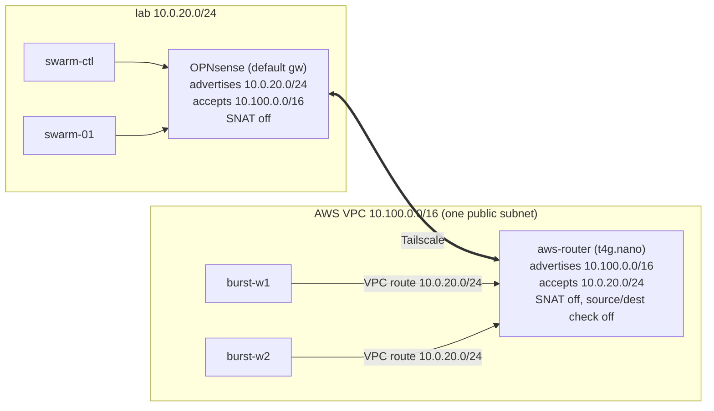
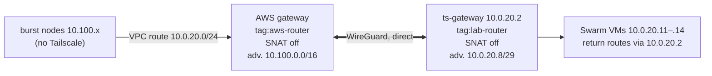

# Network: Address Plan and Paths

**Status:** 2026-10-20. On-prem lab network is live. The AWS VPC is built (`terraform/aws`, #45). The burst-tier link is **decided** ([ADR 0007](adrs/0007-site-to-site-with-two-linux-tailscale-routers.md)): two Linux Tailscale routers, `ts-gateway` in the lab (running, set up by hand) and a gateway instance in the VPC (not built). Read **section 2.2** for the current design; sections 2 and 2.1 are kept as the history of how it was reached.

**Audience:** anyone adding a network, a VPC, or a node that has to reach the cluster.

**Related:** [docs/terraform.md](terraform.md) (VM IPs), [docs/ansible.md](ansible.md) (Swarm role), [ADR 0003](adrs/0003-configure-onprem-with-ansible-bake-burst-workers-with-packer.md) (how burst workers boot and join).

---

## 1. Address plan

Every range below must stay distinct. Check this table before choosing a new one, especially the AWS VPC CIDR.

| Range | Used by | Set where |
|---|---|---|
| `10.0.20.0/24` | Lab VLAN 20, gateway OPNsense `10.0.20.1` | OPNsense, `terraform/proxmox` (VM IPs) |
| `10.0.20.100` | Cluster VIP (keepalived), target of `*.hba.internal` ([cluster-vip.md](cluster-vip.md)) | Ansible `group_vars/all.yml`, OPNsense Unbound override |
| `10.0.20.2` | `ts-gateway`, the lab-side Tailscale router (LXC) | Proxmox, by hand for now (section 2.2) |
| `10.0.20.8/29` | Block advertised by `ts-gateway`: the Swarm VMs `.11–.14`. Kubernetes VMs get their own small block. | `ts-gateway` (`--advertise-routes`) |
| `192.168.100.0/24` | Home network in front of OPNsense: home gateway `.1`, OPNsense WAN `.38` (double NAT) | home gateway |
| `100.64.0.0/10` | Tailscale device IPs | Tailscale (fixed) |
| `172.17.0.0/16` | `docker0`, Docker's default local bridge | Docker default |
| `172.18.0.0/16` | `docker_gwbridge`, created on each Swarm node | Docker default |
| `10.200.0.0/16` | Swarm overlay networks, one /24 each (`subnet_size: 24`) | `swarm init`, Ansible `swarm` role |
| `10.100.0.0/16` | AWS VPC, three /24 public subnets (`10.100.1.0/24` to `10.100.3.0/24`, one per AZ) | `terraform/aws` ([aws.md](aws.md)) |

**Why the Swarm pool is set explicitly.** Swarm's default pool is `10.0.0.0/8`, handed out as /24s in order (`10.0.0.0/24`, `10.0.1.0/24`, …). It contains the lab VLAN, so an overlay network could one day get `10.0.20.0/24`. Containers on it could then no longer reach the real lab hosts, for example Prometheus or MinIO on `obs-01`. The pool can only be set at `swarm init`; changing it later means recreating the swarm.

## 2. Original plan: Tailscale site-to-site between the lab and the VPC

> **History.** The current design is in [section 2.2](#22-decided-2026-10-20-two-linux-tailscale-routers). The AWS-side router, the VPC route and the security group parts below are close to what was decided. The OPNsense steps are not: SNAT cannot be turned off there, so a Linux container takes over the lab-side role. The problem statement and the MTU section still apply.

### The problem

Swarm is a full mesh. Every node must reach every other node's advertised address in both directions: 2377/tcp (managers only), 7946/tcp+udp (gossip) and 4789/udp (overlay/VXLAN). Today's Tailscale subnet route only covers one direction: Tailscale devices → `10.0.20.0/24`, with SNAT. A burst worker could join the manager, but the on-prem nodes could not reach it back, and with SNAT the manager would see OPNsense's IP instead of the worker's.

### The plan

Connect the two sites with one subnet router each, so every node is reachable at its plain private IP by ordinary routing ([Tailscale site-to-site](https://tailscale.com/kb/1214/site-to-site)):



**Chosen over Tailscale on every Swarm node** because:

* burst workers need no Tailscale login at boot, which shortens the burst critical path ([ADR 0003](adrs/0003-configure-onprem-with-ansible-bake-burst-workers-with-packer.md)) and removes the "Tailscale auth key at boot" open point there;
* the on-prem VMs stay unchanged: OPNsense is already their default gateway and the subnet router, so they need no extra routes.

The cost is one small router instance that is a single point of failure for the burst tier, and route tables on both sides. An ADR records the decision when it is built.

### Build steps

**1. Tailscale policy** (admin console, or optionally the [Tailscale Terraform provider](https://registry.terraform.io/providers/tailscale/tailscale/latest/docs)):

* a tag `tag:aws-router`;
* `autoApprovers` for the route `10.100.0.0/16` → `tag:aws-router`;
* grants in both directions between `10.0.20.0/24` and `10.100.0.0/16`. With SNAT off, Tailscale filters on these real subnet IPs.

**2. AWS, in `terraform/aws`** (always-on scaffolding):

| Resource | Notes |
|---|---|
| VPC `10.100.0.0/16` + internet gateway | |
| One public subnet, public IPs on | Router and workers need outbound internet (Tailscale coordination, GHCR). No NAT gateway: about $32/month whether used or not. A production setup would use a private subnet + NAT; name this in the limitations. |
| Route table | `0.0.0.0/0` → internet gateway; `10.0.20.0/24` → the router's network interface (`aws_route.network_interface_id`) |
| Router instance (`t4g.nano`) | `source_dest_check = false`, otherwise AWS drops every packet it forwards. Created once, **stopped between test runs** (Tailscale identity survives on disk; stopped cost is the disk only). |
| Router security group | Inbound UDP 41641 from anywhere (direct Tailscale connection instead of the DERP relay); all traffic from `10.100.0.0/16` |
| Burst worker security group | 7946/tcp+udp and 4789/udp from `10.0.20.0/24` and from inside the VPC |
| Both security groups | ICMP type 3 code 4 ("fragmentation needed"), see MTU below |

**3. Router configuration** (user-data at first boot):

* `net.ipv4.ip_forward=1`;
* `tailscale up --advertise-routes=10.100.0.0/16 --accept-routes --snat-subnet-routes=false --advertise-tags=tag:aws-router --auth-key=…`.

The auth key never goes into plain user-data or Terraform outputs (Actions logs are public): use a single-use tagged key, or a SecureString in SSM Parameter Store read through the instance role, the same mechanism ADR 0003 proposes for the Swarm join token.

**4. OPNsense** (Tailscale plugin):

* accept subnet routes, so it learns `10.100.0.0/16`;
* SNAT off for subnet routes. Check whether the plugin exposes it in the GUI; a shell-only change may be reset when the plugin restarts;
* firewall rule on the Tailscale interface: `10.100.0.0/16` → `10.0.20.0/24` on the Swarm ports.

The laptop and the Pi keep working: with SNAT off the VMs see their `100.x` addresses, and OPNsense already routes those back.

**5. Swarm side:**

* rebuild nothing: Swarm nodes keep advertising their LAN IPs, burst workers advertise their VPC IPs;
* create overlay networks with MTU 1230 or less (see below).

### MTU

Three MTUs meet on this path: VPC 9001, LAN 1500, Tailscale 1280.

* **Overlay traffic** (4789/udp) adds 50 bytes of VXLAN header, so overlay networks need MTU ≤ 1230 to fit the tunnel (`com.docker.network.driver.mtu`).
* **Host-to-host TCP** (2377, 7946) relies on path MTU discovery: the router must be able to send "fragmentation needed" back, which is why the security groups allow that ICMP type. The alternative is clamping TCP MSS on the router.

### Testing, before Swarm is involved

1. Start a throwaway instance in the subnet. Ping its private IP from `swarm-ctl`, and `10.0.20.11` from it.
2. `tcpdump` on `swarm-ctl`: the source IP must be `10.100.x.x`, not OPNsense's. That proves SNAT is off.
3. Check the MTU handling both ways: `ping -M do -s 1252` (1280 on the wire) must succeed, and `ping -M do -s 1400` must fail with "message too long" / "frag needed", not with a silent timeout.
4. Only then join a burst worker to the swarm.

## 2.1 Update 2026-10-17: Tailscale on each burst node, and SNAT on OPNsense

> **History.** This section records the per-node proposal and the tests that ruled it out. The decision is in [section 2.2](#22-decided-2026-10-20-two-linux-tailscale-routers) and [ADR 0007](adrs/0007-site-to-site-with-two-linux-tailscale-routers.md). The policy table below is no longer current.

### What changed from section 2

* **No `aws-router` instance.** Every burst node and the k6 host run Tailscale themselves and join the tailnet with a tag. Tailscale's own [AWS reference architecture](https://tailscale.com/docs/reference/reference-architectures/aws) recommends installing the agent on the VM where possible, and keeps subnet routers for things that cannot run it.
* **The VPC is simpler than planned.** `terraform/aws/network.tf` has no router, no `source_dest_check` change and no route to `10.0.20.0/24`. The burst security group has **no inbound rules**: Tailscale needs none, because of NAT traversal.
* **No NAT gateway, and public IPs on every node.** The reference architecture says everything behind an AWS NAT gateway connects through DERP relays only, which would add latency and skew the burst timings. Public IPv4 is about $0.005 per hour per running node.
* **Burst nodes must accept subnet routes.** Linux clients do not by default: `tailscale up … --accept-routes`. Without it the join succeeds and every packet to the lab goes nowhere. (The CI Pi hit the same problem on 2026-10-02.) OPNsense keeps "Accept Subnet Routes" **off**: it has no remote subnet to learn.

### Finding: SNAT cannot be disabled on OPNsense

The plan required "SNAT off for the subnet route" on OPNsense (section 2, step 4). On 2026-10-17 a burst node pinged `swarm-ctl` and `tcpdump` there showed the source `10.0.20.1`, OPNsense's own address, not the node's `100.x`. Evidence on where it comes from:

* Firewall → NAT → Outbound lists only the automatic rules for the **WAN** interface. Nothing there covers VLAN 20 or Tailscale.
* The OPNsense Tailscale plugin has no SNAT setting (Enabled, Advertised Routes, Listen Port, Accept DNS, exit-node options, Accept Subnet Routes).
* Tailscale's [subnet router documentation](https://tailscale.com/kb/1019/subnets) says `--snat-subnet-routes=false` works with **Linux only**. OPNsense is FreeBSD. The page does not say what other platforms do.

Conclusion (an inference, not documented behaviour): `tailscaled` on FreeBSD always rewrites the source. The source of lab-bound traffic from burst nodes is therefore `10.0.20.1`. Traffic from the lab to a burst node is not rewritten. Lab VMs already send `100.x` traffic to their default gateway, OPNsense.

### Options for the lab side (open, decided in ADR 0007)

| | What | Cost / risk |
|---|---|---|
| **A** | Keep SNAT and test whether Swarm copes. Docker takes a worker's address from `docker swarm join --advertise-addr`, not from the packet source. Test: join one throwaway node, check `docker node inspect <node> --format '{{.Status.Addr}}'` shows its `100.x`, then ping between containers across the overlay. | About 20 minutes. Not verified: whether VXLAN (4789/udp) tolerates a rewritten outer source address. |
| **B** | A small **Linux** subnet router in VLAN 20 (an LXC container, if the Proxmox provider can express the TUN device passthrough; otherwise a 512 MB VM) with `--snat-subnet-routes=false`. Lab VMs need a return route `100.64.0.0/10` via it ([Tailscale requirement](https://tailscale.com/kb/1019/subnets)). Tailscale prefers the most specific route, so it can advertise only the small block holding the cluster VMs while OPNsense keeps serving CI and Ansible. | One more guest and a route on every lab VM. Needs the cluster VMs in one small contiguous block (not checked). |
| **C** | Tailscale on every Swarm VM. No subnet router for burst traffic. | Lab-to-lab traffic would be tempting to move onto the tunnel, which hurts the fairness of the comparison. Ansible changes on every node. |

Order: A first, because it is cheap and may remove the need for B. B if A fails.

**Result of A (2026-10-20): failed.** A throwaway Amazon Linux instance on the tailnet joined the swarm as a worker with `--advertise-addr` and `--data-path-addr` set to its `100.x` address. On `swarm-ctl`, `docker node inspect <node> --format '{{.Status.Addr}}'` printed **`10.0.20.1`**: the manager recorded the node under OPNsense's rewritten address, not the advertised one. Attaching a container on the burst node to an attachable overlay (`mtu-test`, MTU 1230) failed with `attaching to network failed … context deadline exceeded`. A capture of 4789/udp on `swarm-01` showed only lab-to-lab overlay traffic. SNAT on OPNsense therefore blocks Swarm, and the lab side needs **B** (a Linux subnet router with SNAT off) or C.

### Tailscale policy (as written 2026-10-17)

Tags (`tagOwners`, owner `autogroup:admin`): `tag:burst`, `tag:loadgen`. Grants as drafted:

| Source | Destination | Ports |
|---|---|---|
| `tag:burst` | `10.0.20.0/24` | tcp 2377, 7946; udp 7946, 4789 |
| `10.0.20.0/24` | `tag:burst` | tcp 7946; udp 7946, 4789 (lab to burst; works because lab VMs route `100.x` through OPNsense) |
| `tag:burst` | `tag:burst` | tcp 7946; udp 7946, 4789 |
| `tag:loadgen` | `10.0.20.100/32` (VIP) | tcp 80, 443 |
| `tag:loadgen` | `10.0.20.1/32` (Unbound, split DNS) | tcp 53, udp 53 |

The first draft had `"ip": ["80, 443"]`, which is one malformed string; each protocol and port is its own entry (`tcp:80`). Check the saved policy against this table.

### How the test was done, and a trap

A test ping is easy to misread on the lab side: OPNsense itself pings the VMs about once a second (a new `id` each time, `seq 0`), so `10.0.20.1` appears in any capture. Tag the test packet instead: `ping -c 3 -s 200 10.0.20.11` on the burst node, and on `swarm-ctl` `sudo tcpdump -ni any 'icmp and greater 200'`. Only the test packets match. The source on those lines is what matters.

## 2.2 Decided 2026-10-20: two Linux Tailscale routers

Decision and reasons: [ADR 0007](adrs/0007-site-to-site-with-two-linux-tailscale-routers.md).



Everything else in `10.0.20.0/24` (`obs-01`, the VIP, CI's access to non-cluster hosts) still goes through OPNsense, with its SNAT.

### Lab side: `ts-gateway` (running, set up by hand)

| Item | Setting |
|---|---|
| Container | Unprivileged LXC, Debian/Ubuntu, 1 core, 256–512 MB RAM, **4 GB disk** (the default ran out during the Tailscale install), bridge `vmbr1` VLAN 20, `10.0.20.2/24`, gateway `10.0.20.1` |
| DNS | Set to `10.0.20.1` in the container's DNS tab. Left empty, Proxmox copies the host's resolver (`192.168.100.1`, the home gateway), which VLAN 20 cannot use. Proxmox rewrites the container's network files at start, so netplan inside it is not the place. |
| TUN device | Resources → Add → Device Passthrough `/dev/net/tun`, or on the host `pct set <CTID> --dev0 /dev/net/tun` ([Tailscale LXC guide](https://tailscale.com/kb/1130/lxc-unprivileged)). Older Proxmox: the two `lxc.cgroup2…` / `lxc.mount.entry…` lines in `/etc/pve/lxc/<CTID>.conf`. |
| Forwarding | `net.ipv4.ip_forward = 1` in `/etc/sysctl.d/99-tailscale.conf` |
| Tailscale | `tailscale up --advertise-tags=tag:lab-router --advertise-routes=10.0.20.8/29 --snat-subnet-routes=false --accept-routes`, a non-ephemeral key, **key expiry disabled** |
| Port | `PORT="41642"` in `/etc/default/tailscaled`. 41641 is already used by OPNsense's own Tailscale on the WAN, which kept a static-port rule from working. |

### OPNsense and the double NAT

* Firewall → NAT → Outbound in **Hybrid** mode, a manual rule above the automatic ones: WAN, UDP, source `10.0.20.2/32` port 41642, translation interface address, **static port**. Check with `pfctl -s nat | grep 10.0.20.2` (line ends in `static-port`) and `pfctl -ss | grep 41642` (the port in brackets stays 41642).
* OPNsense's WAN is `192.168.100.38` **behind the home gateway**, which translates again and randomises ports. `tailscale netcheck` on `ts-gateway` therefore shows `MappingVariesByDestIP: true` and a random port. (Its CLI probes may also use their own socket, so its port is not proof either way.)
* This is solved on the AWS side: a peer with a public IP and **inbound UDP 41641 open** gets a direct path. Tested with a throwaway instance: `pong from burst-test via 3.72.95.67:41641 in 14ms` (52 ms through DERP before the rule).

### Return routes on the cluster VMs

Every VM in an advertised block needs both routes; without them, replies go to OPNsense and connections through `ts-gateway` hang (ping may still work):

```yaml
# /etc/netplan/60-tailscale-routes.yaml, mode 0600; check the interface name with ip -br link
network:
  version: 2
  ethernets:
    eth0:
      routes:
        - to: 10.100.0.0/16   # VPC, through the AWS gateway
          via: 10.0.20.2
        - to: 100.64.0.0/10   # tailnet devices (laptop, CI Pi)
          via: 10.0.20.2
```

Apply with `sudo netplan try` and confirm `ip route` still has `default via 10.0.20.1` before accepting. **Order:** routes on all VMs first, then advertise `10.0.20.8/29`. To be codified in Ansible for the Swarm group (and the Kubernetes group later), with the router address as one variable.

### AWS side: gateway instance (not built)

`t3.micro` in a public subnet, `source_dest_check = false`, `tag:aws-router`, advertising `10.100.0.0/16` with `--snat-subnet-routes=false --accept-routes`, key expiry disabled. VPC route table: `10.0.20.0/24` → the gateway's network interface. Gateway security group: inbound **UDP 41641** from `0.0.0.0/0`, all traffic from inside the VPC. Burst security group: 7946 tcp+udp and 4789 udp from `10.0.20.8/29` and from the VPC. Stopped between runs; started by the test runner.

### Tailscale policy

* `tagOwners`: `tag:lab-router`, `tag:aws-router` (owner `autogroup:admin`).
* `autoApprovers.routes`: `10.0.20.8/29` → `tag:lab-router`, `10.100.0.0/16` → `tag:aws-router`.
* Grants on subnets: `10.100.0.0/16` → `10.0.20.8/29` on tcp 2377, 7946 and udp 7946, 4789; the reverse on tcp 7946, udp 7946, 4789; `10.100.0.0/16` → `10.0.20.100/32` on tcp 80, 443 (k6).
* Keep the existing rules for tailnet devices: since the `/29` goes through `ts-gateway` without SNAT, the laptop and CI Pi need grants for their own access (SSH) to those addresses as before.

### Checks before a test run

1. On `ts-gateway`: `tailscale ping <AWS gateway>` says `via <public IP>:41641`, not DERP.
2. From a Swarm VM: `ping` a burst node's VPC address.
3. After a burst node joins: `docker node inspect <node> --format '{{.Status.Addr}}'` shows its **`10.100.x`** address.

## 3. Sources

- [Docker: `swarm init`, `--default-addr-pool`](https://docs.docker.com/reference/cli/docker/swarm/init/)
- [Docker: overlay network driver, ports and MTU](https://docs.docker.com/engine/network/drivers/overlay/)
- [Tailscale: subnet routers](https://tailscale.com/kb/1019/subnets)
- [Tailscale: site-to-site networking](https://tailscale.com/kb/1214/site-to-site)
- [Tailscale: connect to an AWS VPC using subnet routes](https://tailscale.com/kb/1021/install-aws)
- [Tailscale: AWS reference architecture](https://tailscale.com/docs/reference/reference-architectures/aws)
- [Tailscale: install on AWS EC2](https://tailscale.com/docs/install/cloud/aws/quickstart)
- [Tailscale: grants syntax](https://tailscale.com/kb/1324/grants)
- [Terraform AWS provider: `aws_route`](https://registry.terraform.io/providers/hashicorp/aws/latest/docs/resources/route), [`aws_instance` (`source_dest_check`)](https://registry.terraform.io/providers/hashicorp/aws/latest/docs/resources/instance)
