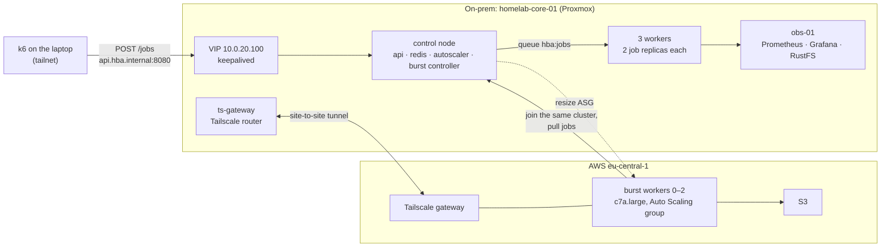

# 2. Architecture & IaC Design

## 2.1 System Context

Two different network paths share the diagram: **load** enters through the VIP from the tailnet, while **burst workers** join the cluster through a site-to-site Tailscale link between two Linux routers ([ADR 0007](../adrs/0007-site-to-site-with-two-linux-tailscale-routers.md)). The load generator is a laptop on the tailnet, outside every cluster; an AWS host was planned and dropped after the first pilot showed the laptop far from its limit ([ADR 0008](../adrs/0008-run-k6-from-the-laptop-not-an-aws-host.md)).

## 2.2 Deployment

Each orchestrator has its own VM set of **1 control node + 3 workers**, all 2 vCPU / 4 GB ([ADR 0006](../adrs/0006-cluster-size-one-control-three-workers.md)). The control node runs the control plane, `api`, `redis` and the autoscalers, and **no job replicas**; each worker runs two. Only one set is powered on at a time ([ADR 0010](../adrs/0010-k3s-as-a-second-vm-set-switched-by-active-cluster.md)).

| VMs (VMID) | IPs | Role | Powered on |
|---|---|---|---|
| `swarm-ctl`, `swarm-01..03` (211–214) | 10.0.20.11–.14 | Docker Swarm 29.8 | Swarm tests |
| `k8s-ctl`, `k8s-01..03` (221–224) | 10.0.20.8, .9, .10, .15 | k3s 1.37 + KEDA 2.21 | Kubernetes tests |
| `obs-01` (230) | 10.0.20.30 | Prometheus, Grafana, RustFS (S3-compatible store) | always |
| `ts-gateway` (202) | 10.0.20.2 | lab-side Tailscale router | always |
| `burst-<instance-id>` (EC2) | 10.100.x | worker of the active cluster | 0–2, on demand |

**Host budget** (Ryzen 7 5700G, 8 cores / 16 threads, 32 GB): one cluster + `obs-01` + OPNsense use 12 vCPU / 22 GB; both clusters at once would need 38 GB, so they never run together. The on-prem ceiling is therefore **6 job replicas**, one per vCPU, within the 8 physical cores. Load beyond it is the burst tier's job.

## 2.3 Infrastructure as Code

**Terraform decides what exists, Ansible decides what runs on it,** and nothing is set by hand.

- **Terraform**, two roots with separate S3 state: `proxmox/` (the template and every VM from one map) and `aws/` (VPC, gateway, bucket, IAM, the burst launch templates and Auto Scaling groups). One variable, `active_cluster`, powers a cluster set on or off ([terraform.md](../terraform.md) §5.1).
- **Ansible** reads its hosts straight from Terraform state. Each VM carries two labels, `cluster` and `node_role`, and one `constructed` inventory file turns them into groups such as `swarm_workers` or `k8s_control` ([ADR 0002](../adrs/0002-terraform-labels-ansible-constructed-inventory.md)). Roles install Docker/Swarm or k3s, the stacks, keepalived, the observability stack and the Tailscale router.
- **CI:** lint, `plan` and `--check` on every pull request; `apply` and playbooks after a merge to `main`, on a self-hosted Raspberry Pi, the only machine with credentials for real infrastructure. App images are built on GitHub's runners and pinned by `sha-<commit>` tag.
- **Pinned versions** throughout (OS image by date, a dated apt snapshot, Docker, k3s, chart and image versions), so a run in week 10 uses the software of week 4.
- **Burst workers boot from a stock Ubuntu AMI** and install their runtime from user data. Baking an image with Packer ([ADR 0003](../adrs/0003-configure-onprem-with-ansible-bake-burst-workers-with-packer.md)) is planned but not built; the measured time-to-capacity includes the install.

## 2.4 One job, two tiers: CPU parity

A queue job can run on-prem or on AWS, from the same image. The worker's image processing (ImageSharp, .NET 10) uses hardware intrinsics that the .NET JIT picks **at runtime** from what the CPU reports (AVX2, AVX-512). If the tiers exposed different instruction sets, the same job would run different machine code on each, and a time difference would measure the CPU model, not the burst mechanism.

- **On-prem:** the VMs use CPU type `host`, so they see the 5700G's full Zen 3 feature set (AVX2, no AVX-512). The provider's default, `x86-64-v2-AES`, hides AVX and AVX2 and would have made only the on-prem tier slower.
- **AWS, and a correction:** the design first picked `c6a.large` (Zen 3, 2 vCPU) to match the CPU family. The first burst test showed its 2 vCPUs are **one physical core with two threads**: two replicas shared it, and a job took 4.48 s against 2.6 s on-prem. `c7a.large` (Zen 4) has **two physical cores**: 2.78 s per job, 18 % cheaper per job despite a 34 % higher hourly price ([ADR 0009](../adrs/0009-separate-burst-controller-resizing-an-auto-scaling-group.md), [loadtest.md](../loadtest.md) §4.1). It also has AVX-512, which on-prem lacks. The worker's `hba_worker_info` metric reports a 256-bit vector width on `c7a`, so its general vector code keeps the on-prem width, but AVX-512-specific code paths can't be ruled out. **Lesson: a vCPU count is not a core count.**
- **Measured, not assumed:** every job is recorded with a `tier` label. In the burst runs an AWS job's median was 4–6 % slower than an on-prem job's, with a longer tail (p95 3.6–3.8 s against 3.0 s).
